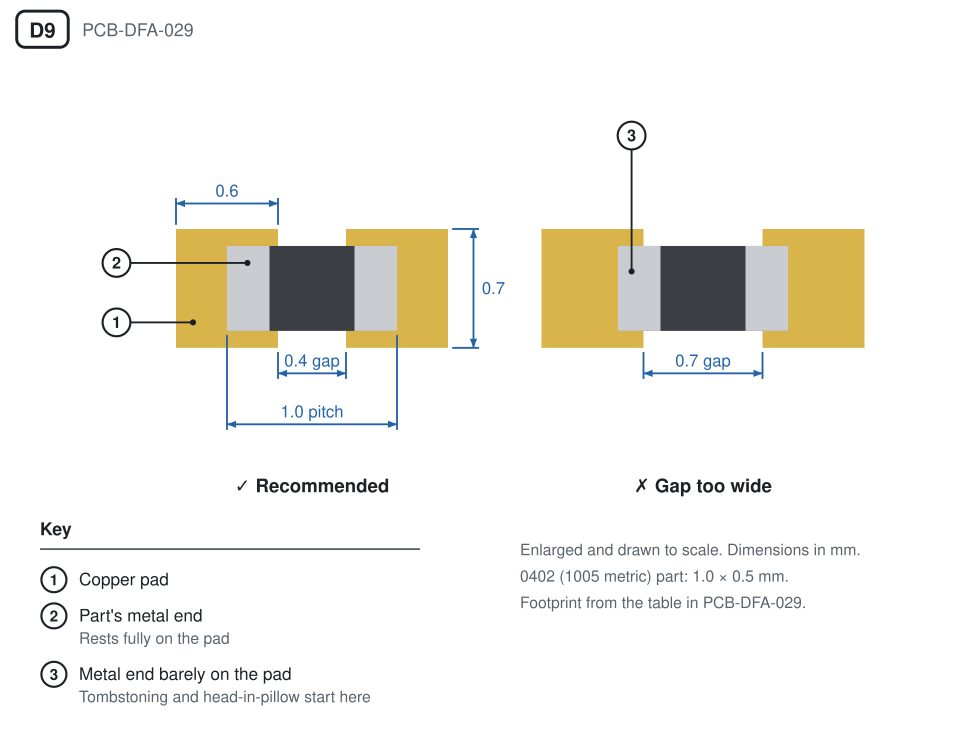
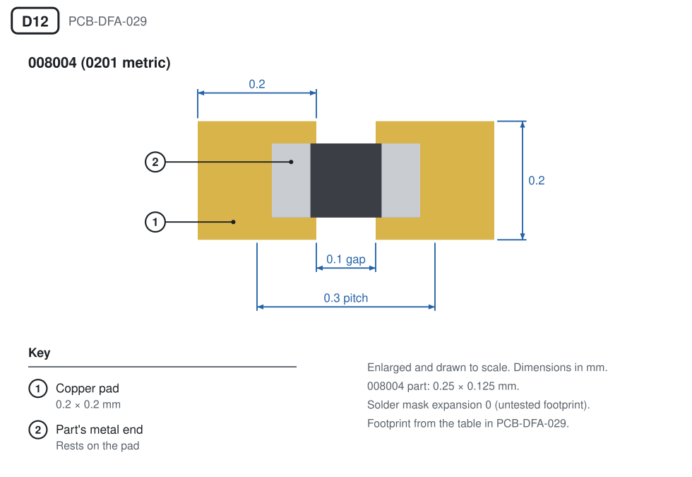
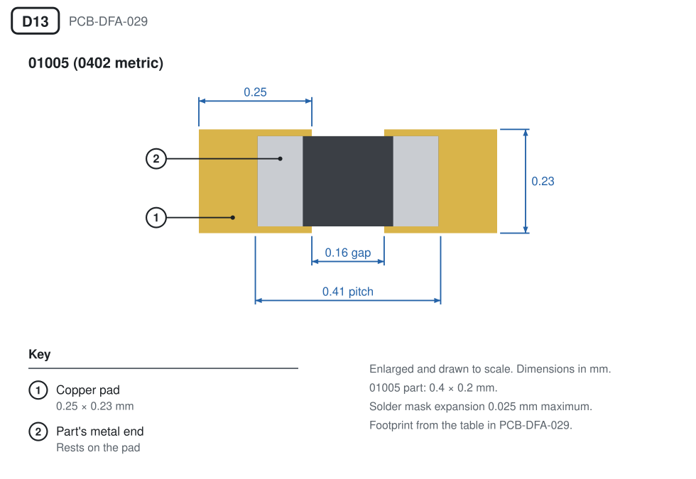
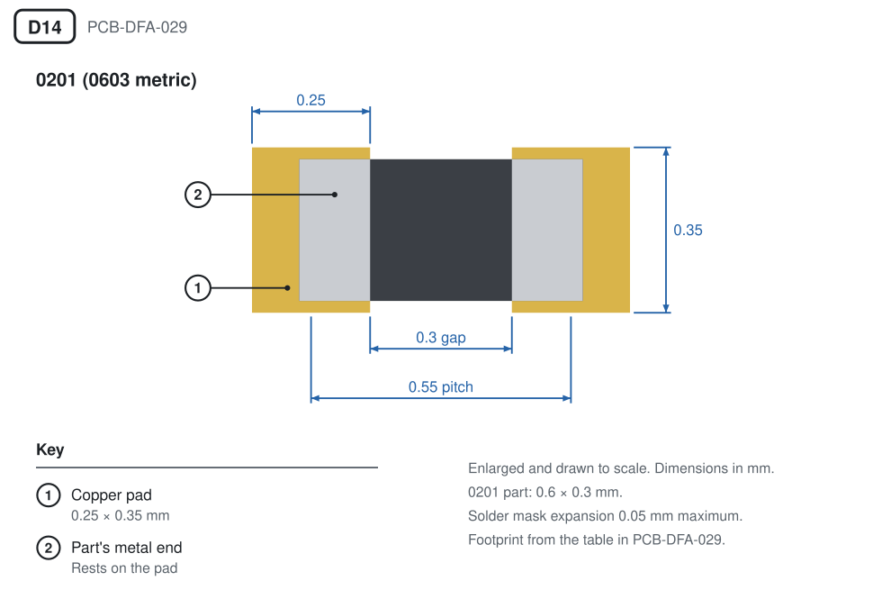
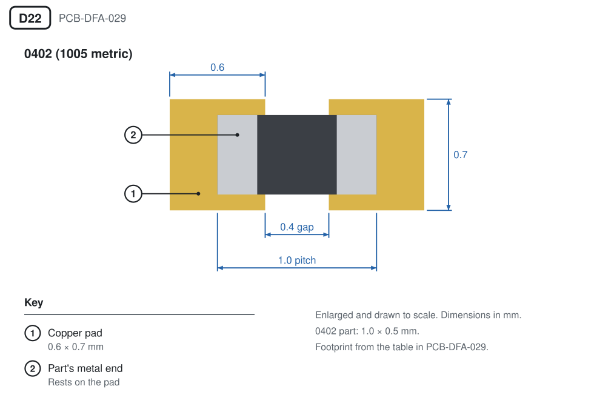
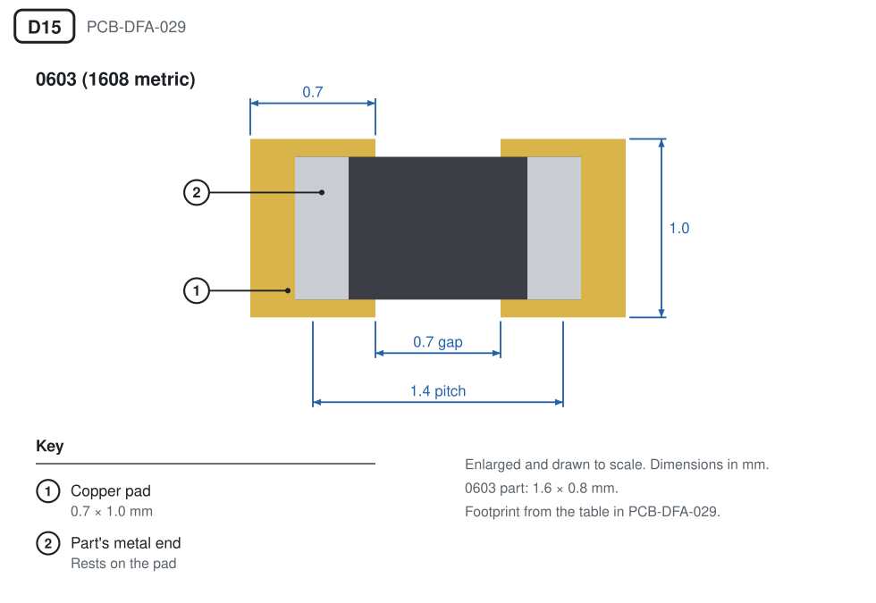
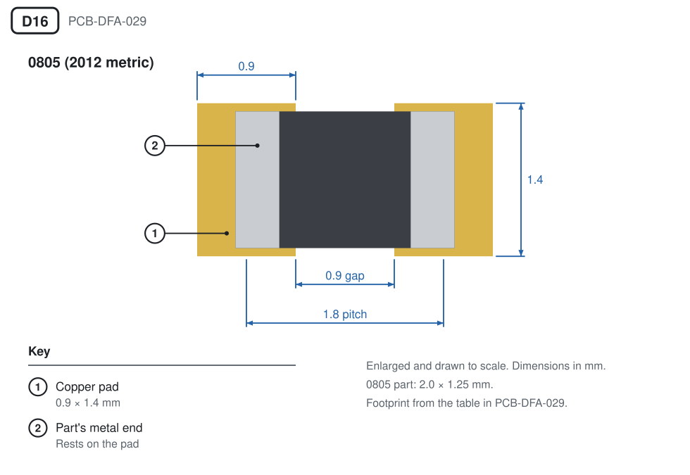
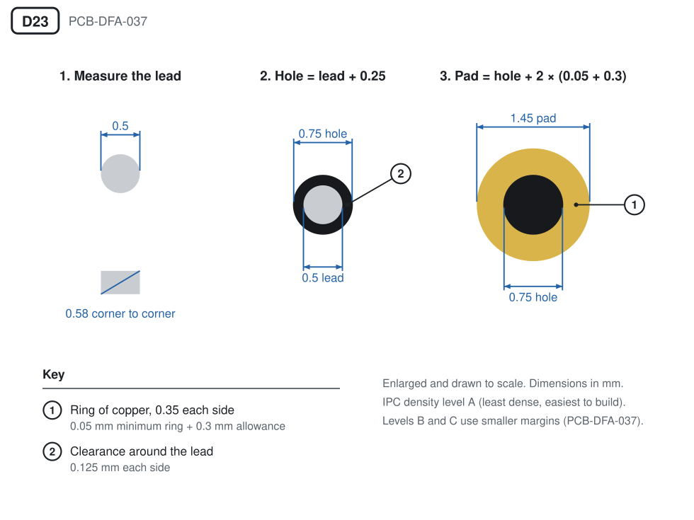

# Footprints and the component library

A footprint (also called a land pattern) is the set of copper pads, solder mask openings, paste openings and markings that a part is soldered to.
Every footprint on a board comes from a library: one that came with the design software, one downloaded from a part maker or distributor, or one you drew yourself.

More assembly defects start in the library than anywhere else a designer controls.
A tombstoned resistor, a bridged QFN or an LED soldered backwards usually traces back to a footprint, not to the factory.
This page covers what a good footprint looks like.
The paste layer inside each footprint is covered in [PCB-DFA-019](../05-assembly/01-solder-paste-and-stencils.md).

## PCB-DFA-029: Use proven footprints for chip resistors and capacitors

**Recommendation:** Use the footprints in the table below for chip resistors and capacitors.
They are strongly recommended for industrial and consumer products.
You can adjust them, but do it knowingly, and keep the gap between the pads (see the warning below).

**Why:** For small chip parts, the gap between the two pads matters most.
If the pads sit too far apart, the part's metal ends don't both rest on solder: one end lifts while the other wets, and the part stands up on end (tombstoning), or one end looks soldered but never wetted (head-in-pillow).
Many library footprints have gaps that are too wide for 0402 and smaller parts.

**Typical values:** Footprints proven over millions of placements at one assembler (Worthington Assembly, Rev E).
All dimensions in mm; pad length runs along the part, pad width across it.

| Size (inch / metric) | Pad length × width | Pitch (pad center to center) | Gap between pads | Solder mask expansion |
|---|---|---|---|---|
| 008004 / 0201 | 0.20 × 0.20 | 0.30 | 0.10 | 0 (untested footprint) |
| 01005 / 0402 | 0.25 × 0.23 | 0.41 | 0.16 | 0.025 maximum |
| 0201 / 0603 | 0.25 × 0.35 | 0.55 | 0.30 | 0.05 maximum |
| 0402 / 1005 | 0.60 × 0.70 | 1.00 | 0.40 | |
| 0603 / 1608 | 0.70 × 1.00 | 1.40 | 0.70 | |
| 0805 / 2012 | 0.90 × 1.40 | 1.80 | 0.90 | |

⚠️ **If you change these, keep the gap.**
On 0201 parts, a gap just 0.1 mm wider than shown causes serious tombstoning and head-in-pillow problems, and 0402 parts are nearly as sensitive.
0603 and larger parts are much more forgiving.

*D9 is enlarged and drawn to scale.
On the left is the recommended 0402 footprint: two copper pads 0.6 mm long and 0.7 mm wide, 1.0 mm apart center to center, leaving a 0.4 mm gap.
The 1.0 × 0.5 mm part sits with both metal ends fully on the pads.
On the right, the gap is 0.7 mm, and the part's metal ends only just reach the pads, which is how tombstoning and head-in-pillow start.*

The other sizes in the table, each enlarged and drawn to scale:

*D12.
008004 (0201 metric): pads 0.2 mm long and 0.2 mm wide, 0.3 mm pitch, 0.1 mm gap; the part is 0.25 × 0.125 mm.
Solder mask expansion 0 (untested footprint).*

*D13.
01005 (0402 metric): pads 0.25 mm long and 0.23 mm wide, 0.41 mm pitch, 0.16 mm gap; the part is 0.4 × 0.2 mm.
Solder mask expansion 0.025 mm maximum.*

*D14.
0201 (0603 metric): pads 0.25 mm long and 0.35 mm wide, 0.55 mm pitch, 0.3 mm gap; the part is 0.6 × 0.3 mm.
Solder mask expansion 0.05 mm maximum.*

*D22.
0402 (1005 metric): pads 0.6 mm long and 0.7 mm wide, 1.0 mm pitch, 0.4 mm gap; the part is 1.0 × 0.5 mm.*

*D15.
0603 (1608 metric): pads 0.7 mm long and 1.0 mm wide, 1.4 mm pitch, 0.7 mm gap; the part is 1.6 × 0.8 mm.*

*D16.
0805 (2012 metric): pads 0.9 mm long and 1.4 mm wide, 1.8 mm pitch, 0.9 mm gap; the part is 2.0 × 1.25 mm.*

**What goes wrong if you don't:** Tombstoned and half-soldered small parts, found at inspection and reworked by hand, or missed and found in the field.

**Example:** Since about 2017, every tombstoning problem at one assembler has traced back to the footprint.
The usual cause was a default library footprint, or one downloaded and never checked.

**Applies to:** Industrial, consumer and similar products.
Mission-critical designs (space, aviation and similar) should follow the IPC land-pattern rules their customers require.
These footprints are offered as a downloadable KiCad library; the 0402 and 0201 are also available for two other design tools.

**Sources:** [Discrete Component Footprint Recommendations, Rev E](https://www.worthingtonassembly.com/s/Discrete-Component-Footprints-Rev-E.pdf) (Worthington Assembly, PDF) and its [KiCad library](https://www.worthingtonassembly.com/s/Worthington_Assemblypretty.zip); [The Perfect 0402 Footprint](https://www.worthingtonassembly.com/perfect-0402-footprint) and [The Perfect 0201 Footprint](https://www.worthingtonassembly.com/perfect-0201-footprint) (Worthington Assembly); [“The selective soldering process”](https://www.buzzsprout.com/1066066/episodes/7337971-the-selective-soldering-process) (Jan 2021), [05:00](https://www.buzzsprout.com/1066066/episodes/7337971?t=300)–08:00; [“Showstoppers that delay PCB assembly w/ Production Manager, Rob OConnell”](https://www.buzzsprout.com/1066066/episodes/9741439-showstoppers-that-delay-pcb-assembly-w-production-manager-rob-oconnell) (Dec 2021), [27:00](https://www.buzzsprout.com/1066066/episodes/9741439?t=1620)–29:00; [“All the Tricks and Gotchas in Surface Mount Assembly (Repost from the Coriolis Effect)”](https://www.buzzsprout.com/1066066/episodes/11006453-all-the-tricks-and-gotchas-in-surface-mount-assembly-repost-from-the-coriolis-effect) (Jul 2022), [01:36:00](https://www.buzzsprout.com/1066066/episodes/11006453?t=5760)–01:39:00.

*Last reviewed: 2026-11-03*

---

## PCB-DFA-030: Use one footprint per package size, not one per part maker

**Recommendation:** Keep one footprint for each chip size (one 0402, one 0603, and so on) and use it for every resistor and capacitor of that size, whoever makes the part.

**Why:** Assemblers design stencil openings and program inspection machines footprint by footprint.
Two parts of the same size from two makers, each with its own downloaded footprint, look like two different footprints and need two sets of work.

**What goes wrong if you don't:** Extra engineering time on every new job, and more chances for a mistake.

**Example:** Designs regularly arrive with as many as 16 different 0402 footprints on one board.

**Applies to:** General practice.

**Sources:** [“Building the factory of the future with CircuitHub CEO, Andrew Seddon”](https://www.buzzsprout.com/1066066/episodes/19621440-building-the-factory-of-the-future-with-circuithub-ceo-andrew-seddon) (Aug 2026), [24:00](https://www.buzzsprout.com/1066066/episodes/19621440?t=1440)–26:00.

*Last reviewed: 2026-11-03*

---

## PCB-DFA-031: Check every footprint you didn't draw yourself, against the datasheet and a real part

**Recommendation:** Check every downloaded or library footprint before you use it.
Compare it with the part maker's recommended land pattern, and print it 1:1 and lay a real part on it, or measure the part with calipers.
Read the datasheet drawing carefully: many leadless parts are drawn from the bottom, and a footprint drawn from a bottom view comes out mirrored.

**Why:** Downloaded footprints are often wrong: off grid, the wrong pad sizes, or mirrored.
Datasheet drawings are often made by people who never handled the part, and part tolerances only show up over many builds.

**What goes wrong if you don't:** A part that doesn't fit, a mirrored chip that can't be fitted at all, or a board respin.

**Example:** One assembler catches a footprint drawn from a bottom view about once a month.

**Applies to:** General practice.
Treat a new footprint as proven only after it has been soldered about 100 times.

**Sources:** [“Building the factory of the future with CircuitHub CEO, Andrew Seddon”](https://www.buzzsprout.com/1066066/episodes/19621440-building-the-factory-of-the-future-with-circuithub-ceo-andrew-seddon) (Aug 2026), [23:00](https://www.buzzsprout.com/1066066/episodes/19621440?t=1380)–24:00; [“How Joel Murphy went from visual artist to electronics design engineer”](https://www.buzzsprout.com/1066066/episodes/5963659-how-joel-murphy-went-from-visual-artist-to-electronics-design-engineer) (Oct 2020), [01:03:00](https://www.buzzsprout.com/1066066/episodes/5963659?t=3780)–01:05:00; [“How to build and manage a great team w/ Eli Hughes of Tzero Labs (Part 1)”](https://www.buzzsprout.com/1066066/episodes/6828622-how-to-build-and-manage-a-great-team-w-eli-hughes-of-tzero-labs-part-1) (Dec 2020), [09:00](https://www.buzzsprout.com/1066066/episodes/6828622?t=540)–11:00.

*Last reviewed: 2026-11-03*

---

## PCB-DFA-032: Put a solder mask dam between every pad of a fine-pitch part

**Recommendation:** Give every pad of a fine-pitch part (0.5 mm pitch and finer) its own solder mask opening, so a thin strip of mask (a dam) separates each pad from the next.
Never use one large mask opening around a whole row of pads.
If your fab says the dams are too thin, ask what they can do rather than accept their removal.
What's easy for the fab may make the assembler's work very difficult.

**Why:** During reflow, solder flows wherever there's bare copper.
A dam between the pads keeps each joint separate.
Without it, the solder runs together along the row into one long bridge.

**Typical values:** 0.25 mm (10 mil) between copper pads, made up of 0.075 mm (3 mil) of mask registration on each side and a 0.1 mm (4 mil) dam in the middle.
Green solder mask can hold a 0.075 mm (3 mil) dam, but 0.1 mm is recommended for every color.
Where the pitch is too fine for 0.25 mm between pads (0.4 mm pitch, for example), trim the copper pads, or use a fab that images solder mask with a laser, which needs less registration: 0.2 mm copper and a 0.3 mm opening leaves the same 0.1 mm dam.
Never give up the dam itself.

*D10 is enlarged and drawn to scale.
At the top, three copper pads of a 0.5 mm-pitch part, each 0.25 mm wide, with 0.25 mm between them.
Each pad has its own solder mask opening, 0.075 mm larger than the pad on each side, which leaves a 0.1 mm strip of mask, the dam, between neighboring pads.
At the bottom, the same pads share one large opening, with bare board between them and nothing to stop solder bridging from pad to pad.*

**What goes wrong if you don't:** Solder bridges across a whole row of pins, which then have to be cleared by hand on every board.

**Applies to:** General practice.
Laser-imaged solder mask varies by fab; check with yours.

**Sources:** [“Gloves not Mittens”](https://www.buzzsprout.com/1066066/episodes/19269842-gloves-not-mittens) (Jun 2026), [21:00](https://www.buzzsprout.com/1066066/episodes/19269842?t=1260)–23:00 and [26:00](https://www.buzzsprout.com/1066066/episodes/19269842?t=1560)–28:00; [“The PCB CAM Process w/ Dave Wilcox”](https://www.buzzsprout.com/1066066/episodes/8226431-the-pcb-cam-process-w-dave-wilcox) (Mar 2021), [36:00](https://www.buzzsprout.com/1066066/episodes/8226431?t=2160)–41:00; [“An EDA Tool Walks Into a CM w/ Fusion 360 Electronics Product Manager, Ben Jordan”](https://www.buzzsprout.com/1066066/episodes/9171908-an-eda-tool-walks-into-a-cm-w-fusion-360-electronics-product-manager-ben-jordan) (Sep 2021), [56:00](https://www.buzzsprout.com/1066066/episodes/9171908?t=3360)–58:00; [“An overview of bare PCB fabrication w/ Dave Wilcox”](https://www.buzzsprout.com/1066066/episodes/6388663-an-overview-of-bare-pcb-fabrication-w-dave-wilcox) (Nov 2020), [12:00](https://www.buzzsprout.com/1066066/episodes/6388663?t=720); [Solder Mask Dams Between Fine Pitch Devices](https://www.worthingtonassembly.com/blog/2021/11/19/solder-mask-dams-between-fine-pitch-devices) (Worthington Assembly, 2021).

*Last reviewed: 2026-11-03*

---

## PCB-DFA-033: Set the solder mask expansion of fine-pitch pads yourself

**Recommendation:** For parts of 0.5 mm pitch and finer, set the solder mask expansion of each footprint by hand instead of using your design software's default.
Where a pad connects to a copper pour, set its mask opening so the exposed copper matches the other pads of the same part.

![D26: Drawn to scale, plan view of the corner of a 0.5 mm-pitch QFN, three times. Every pad has the same mask opening. On the left, the two ground pads at the corner each have a single trace to a via, and bare FR4 shows around them inside their openings, like every other pad. In the middle, the ground pads are tied straight into a copper pour, and copper fills their openings, so they look larger than the other pads. On the right, the ground pads join the pour through thin thermal spokes, and they look like the other pads again.](images/pour-pad-mask.svg)

*D26 is drawn to scale.
Every pad has the same mask opening, 0.075 mm larger than the pad.
Around a pad with a single trace, the opening shows bare FR4 and only a sliver of trace.
Where a pad is tied straight into a pour, the opening shows copper instead, so the pad looks as big as its opening.
A thermal relief keeps the pour back from the pad and joins it with thin spokes, so the pad looks like its neighbors again.
The pour clearance, relief gap and spoke width are example values.*

**Why:** Default mask expansions suit coarse parts and swallow the dam on fine-pitch ones.
A pad inside a copper pour is defined by its mask opening, not by its copper, so a default expansion makes that pad bigger than its neighbors, and the part gets uneven solder.

**What goes wrong if you don't:** Missing dams, uneven pads, and an assembler who has to guess what you meant.

**Applies to:** General practice.
Above 0.5 mm pitch the default is usually fine.

**Sources:** [“Gloves not Mittens”](https://www.buzzsprout.com/1066066/episodes/19269842-gloves-not-mittens) (Jun 2026), [07:00](https://www.buzzsprout.com/1066066/episodes/19269842?t=420)–11:00 and [21:00](https://www.buzzsprout.com/1066066/episodes/19269842?t=1260)–23:00.

*Last reviewed: 2026-11-03*

---

## PCB-DFA-034: Make pin 1 impossible to miss

**Recommendation:** Make pin 1 of every IC a square or rectangular pad, with the other pads rounded.
Put a pin-1 mark in silkscreen right beside pin 1, outside the part's body, where it can still be seen after the part is placed.
Avoid putting a pin-1 or polarity mark under the part: once the part is placed, the information is lost.
A mark under the part is still better than no mark at all.
Use one kind of mark throughout the board, and don't use a symbol (such as an asterisk) that could mean something else.
Parts that aren't polarized (chip resistors and ceramic capacitors), and parts whose pads only fit one way (SOT-23, SOT-23-5, SOT-223, DPAK), don't need a mark.

**Why:** The assembler sets the orientation of every part from your data, then checks it by eye against the board.
A mark hidden under the part disappears once it's placed; an ambiguous mark gets read the wrong way.

**What goes wrong if you don't:** Parts placed backwards, often on every board in the batch.

**Example:** A designer used an asterisk beside a diode as a footnote marker, because the reference designator wouldn't fit.
The assembler read it as the diode's polarity mark, and every board in the batch was built with that diode backwards.

**Applies to:** General practice.

**Sources:** [“All the Tricks and Gotchas in Surface Mount Assembly (Repost from the Coriolis Effect)”](https://www.buzzsprout.com/1066066/episodes/11006453-all-the-tricks-and-gotchas-in-surface-mount-assembly-repost-from-the-coriolis-effect) (Jul 2022), [49:00](https://www.buzzsprout.com/1066066/episodes/11006453?t=2940)–51:00; [Your Manufacturer Is Stupid: Help Them](https://www.worthingtonassembly.com/s/KiCon-Presentation.pdf) (KiCon 2019 talk, Worthington Assembly, PDF).

*Last reviewed: 2026-11-03*

---

## PCB-DFA-035: Mark diode and LED polarity so it can't be misread

**Recommendation:** Name diode and LED pins K (or C) for the cathode and A for the anode, not 1 and 2.
Mark the cathode in silkscreen beside the cathode pad, not under the part: a K, or a short bar about as long as the pad is wide (one mark is enough).
On through-hole diodes and LEDs, make the cathode the square pad (pin 1).
Check the silkscreen mark against the schematic and the datasheet.

**Why:** Part makers mark polarity inconsistently: some LEDs are marked only underneath, some makers mark the anode on one part and the cathode on another, and some datasheets call the pins 1 and 2 without saying which is which.
Some designers use the square pad for the anode, so a square pad alone isn't proof.
A pin name, a visible mark and the schematic that agree leave nothing to guess.

*D11 is drawn to scale, with dashed lines showing each part's outline.
Top left: an 8-pin IC footprint with a rectangular pin-1 pad, rounded other pads, and a silkscreen dot right beside pin 1, outside the part, so it's still visible after placement.
Top right: the same footprint with all pads alike and the dot inside the outline, hidden once the part is placed.
Bottom left: two 0603 LEDs on the recommended 0603 footprint (0.7 × 1.0 mm pads, 0.7 mm gap); one is marked with the letter K beside the cathode pad, the other with a short bar beside the cathode pad, about as long as the pad is wide.
One mark per LED is enough.
Bottom right: the same footprint with the cathode bar under the part, hidden once the part is placed.
Any mark under a part, pin-1 dot or cathode bar, is lost as soon as the part is placed.*

**What goes wrong if you don't:** LEDs and diodes fitted backwards, which inspection machines can't always catch.

**Applies to:** General practice.

**Sources:** [“Showstoppers that delay PCB assembly w/ Production Manager, Rob OConnell”](https://www.buzzsprout.com/1066066/episodes/9741439-showstoppers-that-delay-pcb-assembly-w-production-manager-rob-oconnell) (Dec 2021), [47:00](https://www.buzzsprout.com/1066066/episodes/9741439?t=2820)–53:00; [“The PCB assembly inspection process”](https://www.buzzsprout.com/1066066/episodes/5713750-the-pcb-assembly-inspection-process) (Oct 2020), [13:00](https://www.buzzsprout.com/1066066/episodes/5713750?t=780)–14:00 and [52:00](https://www.buzzsprout.com/1066066/episodes/5713750?t=3120)–53:00; [Your Manufacturer Is Stupid: Help Them](https://www.worthingtonassembly.com/s/KiCon-Presentation.pdf) (KiCon 2019 talk, Worthington Assembly, PDF); the common library convention that pin 1 of a diode is the cathode (checked Nov 2026).

*Last reviewed: 2026-11-03*

---

## PCB-DFA-036: Draw the real outline of each part in silkscreen, including anything that hangs over the edge

**Recommendation:** Give every footprint a silkscreen outline of the part's real body.
It doesn't have to be detailed, just accurate.
Draw the overhang of any part that hangs past the board edge (connectors, antennas, modules) in silkscreen, past the edge, as it would look if it could print over empty space.
Don't trim it to the board outline; the fab trims silkscreen that falls outside the board itself.
Attach a 3D model where you can.

*D27 is drawn to scale.
On the left, the silkscreen outline stops at the board edge, so nothing shows that the connector hangs 3 mm past it.
On the right, the outline is drawn as if silkscreen could print outside the board.
The fab trims it, but sees it first, and leaves room for the overhang in the panel.
The example connector is 9 mm wide, 6 mm deep on the board and 3 mm past the edge.*

**Why:** The assembler lays out the panel and checks for collisions from your data.
An outline of the real body shows how much room a part needs; an overhang drawn past the edge tells them to keep the next board in the panel clear.
The fab trims silkscreen that falls outside the board, and it sees the overhang first: the drawing is the warning that tells them to adjust the panel.

**What goes wrong if you don't:** A connector that collides with the next board in the panel or a rail, found only after the boards are made.

**Applies to:** General practice.

**Sources:** [“How Loci Controls automates landfill methane gas collection”](https://www.buzzsprout.com/1066066/episodes/5509702-how-loci-controls-automates-landfill-methane-gas-collection) (Sep 2020), [01:11:00](https://www.buzzsprout.com/1066066/episodes/5509702?t=4260); [Your Manufacturer Is Stupid: Help Them](https://www.worthingtonassembly.com/s/KiCon-Presentation.pdf) (KiCon 2019 talk, Worthington Assembly, PDF).

*Last reviewed: 2026-11-03*

---

## PCB-DFA-037: Size plated through-holes and their pads from the lead

**Recommendation:** Size each plated hole from the part's largest lead, and each pad from the hole.
For a square or rectangular lead, measure corner to corner.
If the datasheet gives a hole tolerance like "+0.1 / −0 mm", make the hole 0.1 mm larger than the datasheet's recommended size (for a recommended 1.0 mm hole, make it 1.1 mm).

**Why:** A hole sized to the nominal lead can be too tight for the largest leads in a batch; a pad sized without allowance for drilling and registration can lose its ring of copper.

**Typical values:** Hole = largest lead diameter + a hole allowance.
Pad = hole + 2 × (0.05 mm minimum annular ring + a pad allowance).
The allowances depend on the IPC density level; level A is the easiest to build and the usual choice when there's room.

| IPC density level | Hole = lead + | Pad = hole + 2 × (0.05 + …) | Example: 0.5 mm lead |
|---|---|---|---|
| A (least dense, easiest to build) | 0.25 mm | 0.3 mm | 0.75 mm hole, 1.45 mm pad |
| B (moderately dense) | 0.20 mm | 0.25 mm | 0.70 mm hole, 1.30 mm pad |
| C (most dense, hardest to build) | 0.15 mm | 0.2 mm | 0.65 mm hole, 1.15 mm pad |

*D23 is enlarged and drawn to scale, for density level A.
First, measure the lead: a round lead across its diameter (0.5 mm here), a rectangular lead corner to corner.
Second, the hole is the largest lead plus 0.25 mm: 0.75 mm, leaving 0.125 mm around the lead.
Third, the pad is the hole plus 0.35 mm of copper on each side (a 0.05 mm minimum ring plus 0.3 mm allowance): 1.45 mm.*

**What goes wrong if you don't:** Parts that won't go into their holes, or that need forcing, and pads with too little copper around the hole.

**Applies to:** General practice.

**Sources:** [Determining Plated-Thru-Hole Sizes](https://www.worthingtonassembly.com/determining-platedthruhole-sizes) (Worthington Assembly); [“The basics of the PCB drilling process w/ CAM Engineer Dave Wilcox”](https://www.buzzsprout.com/1066066/episodes/9091552-the-basics-of-the-pcb-drilling-process-w-cam-engineer-dave-wilcox) (Aug 2021), [18:00](https://www.buzzsprout.com/1066066/episodes/9091552?t=1080)–21:00, for asymmetric hole tolerances; IPC-2221 and IPC-2222 (hole and pad sizing, via EDA vendors' summaries, checked Nov 2026).

*Last reviewed: 2026-11-03*

---

## PCB-DFM-007: Don't put copper on non-plated holes

**Recommendation:** Remove the copper pad from every hole that isn't plated, and give its solder mask opening a proper clearance.
Where the hole sits in a copper pour, keep the pour back from the hole's edge.

*D28 is drawn to scale, with the edge of the hole enlarged below each view.
The mask opening is 0.1 mm larger than the hole in both.
On the left, the pour runs up to the hole, so copper shows at its edge and the hole looks plated.
On the right, the pour is kept 0.2 mm back, so bare FR4 shows and the hole is clearly not plated.*

**Why:** A copper ring on a non-plated hole leaves the fab guessing whether the hole should be plated.
A pour that runs right up to the hole shows as a ring of copper at its edge, which looks just like the ring of a plated hole.
A mask opening only a hair larger than the hole leaves a sliver of mask too thin to hold.

**Typical values:** Copper pour kept at least 0.2 mm (8 mil) from the edge of the hole, the minimum fabs list; more with heavy copper, so check with your fab.
Mask clearance of about 0.1 mm (4 mil) around the hole, not 0.025 mm (1 mil).

**What goes wrong if you don't:** Questions from the fab, a delay, or a hole plated that shouldn't be.

**Example:** Designs arrive with pads on half their non-plated holes and none on the other half.

**Applies to:** General practice.

**Sources:** [“An overview of bare PCB fabrication w/ Dave Wilcox”](https://www.buzzsprout.com/1066066/episodes/6388663-an-overview-of-bare-pcb-fabrication-w-dave-wilcox) (Nov 2020), [12:00](https://www.buzzsprout.com/1066066/episodes/6388663?t=720); [“The PCB CAM Process w/ Dave Wilcox”](https://www.buzzsprout.com/1066066/episodes/8226431-the-pcb-cam-process-w-dave-wilcox) (Mar 2021), [41:00](https://www.buzzsprout.com/1066066/episodes/8226431?t=2460)–43:00; fab capability tables for copper to non-plated holes (checked Nov 2026).

*Last reviewed: 2026-11-07*

---

## Related pages
- [Solder paste printing and stencils](../05-assembly/01-solder-paste-and-stencils.md)
- [Component placement](../05-assembly/02-component-placement.md)

---
*From OpenDFX for Printed Circuit Boards by Chris Denney · CC BY-SA 4.0*
