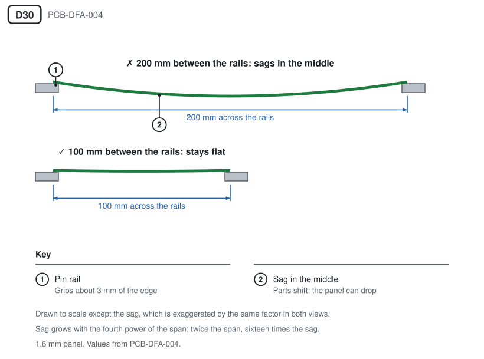

# Why boards are built in panels

A panel (sometimes called an array) is a larger board made up of several copies of your board, or one board with extra material around it, so the factory can handle it more efficiently.
Assembly machines are built to carry boards of a certain size along two edges.
Moving many boards at once is also much faster: every pass through the printer, the placement machine and the oven builds the whole panel.
Most designers never draw a panel themselves, but the board they design can influence how difficult the board will be to panelize and process through the factory.

## PCB-DFA-001: Let your manufacturer design the panel, and approve it before you order bare boards

**Recommendation:** Don't panelize the board yourself.
Send a single board and let the assembler's engineering team design the panel around their own equipment.
If you buy bare boards separately and send them to an assembler, get the assembler to approve the panel drawing before you place the board order.

**Why:** Every factory's machines, conveyors, board racks and clamps are slightly different, and only the factory knows what works best on its line.
A panel that suits one assembler can be awkward or unbuildable for another.

**What goes wrong if you don't:** Boards arrive that the assembler can't run without extra handling.
Sometimes it costs more to handle them than to order new boards.
One assembler estimates that only about two out of five "we already bought the boards" requests can be accommodated, usually at extra cost.

**Example:** A customer arrived with bare boards and parts already in hand for a board half an inch by one inch, too small for the factory's machines to hold.
It could not be built as designed.

**Applies to:** General practice.

**Sources:** Pick, Place, Podcast: [“How PCB panelization methods inform depanelization”](https://www.buzzsprout.com/1066066/episodes/11289685-how-pcb-panelization-methods-inform-depanelization) (Sep 2022), [11:00](https://www.buzzsprout.com/1066066/episodes/11289685?t=660)–12:00; [“How to Send Consigned Material to Your CM”](https://www.buzzsprout.com/1066066/episodes/10182930-how-to-send-consigned-material-to-your-cm) (Mar 2022), [49:00](https://www.buzzsprout.com/1066066/episodes/10182930?t=2940)–51:00; [“PCB Depaneling”](https://www.buzzsprout.com/1066066/episodes/8035612-pcb-depaneling) (Mar 2021), [05:00](https://www.buzzsprout.com/1066066/episodes/8035612?t=300).

*Last reviewed: 2026-10-28*

---

## PCB-DFA-002: Make sure small boards can be panelized, and never send them loose

**Recommendation:** If your board is shorter than about 100 mm (4 in) in the direction of travel, expect it to be built in a panel, and make the panel at least 100 mm long.
Don't order loose single boards for automated assembly.

**Why:** Assembly lines are a row of machines joined by conveyors.
Each conveyor end may leave a gap of up to 19 mm, so two machines side by side can leave 38 mm, and real-world alignment brings that to about 50 mm.
A board has to be longer than twice the gap: anything shorter hangs more than halfway off one conveyor before it reaches the next, tips and falls.
PCBA cleaning machines are also built for panels; a single small board needs to be set inside of a cage or some kind of fixture instead.

**Typical values:** 19 mm allowed gap per conveyor end · about 50 mm (2 in) real gap between machines · boards and panels at least 100 mm (4 in) long in the direction of travel.
From the SMEMA conveyor interface standard (IPC-SMEMA-9851) and one factory's experience.

*D29 is drawn to scale.
Machines sit about 50 mm apart on the line.
A 15 mm board on its own is far shorter than that gap and has nothing under it as it crosses.
A panel has to be longer than twice the gap: anything shorter hangs more than halfway off one conveyor before it reaches the next, and tips.
Twenty-four of the same board in a 120 by 50 mm panel rest on both conveyors at once.*

**What goes wrong if you don't:** Boards drop between machines, or parts near the edge have to be hand-soldered instead of machine-placed.

**Example:** Conference badges, 3 × 4 in, arrived as loose single boards on a tight deadline.
They fell through the gaps between conveyors.
The team had to mask off and hand-solder the edge components that got covered by the machine clamps.

**Applies to:** General practice.

**Sources:** [“Conveyers, An Episode You Didn't Know You Needed”](https://www.buzzsprout.com/1066066/episodes/13980495-conveyers-an-episode-you-didn-t-know-you-needed) (Nov 2023), [32:00](https://www.buzzsprout.com/1066066/episodes/13980495?t=1920)–37:00; [“Back from the Dead and Back from APEX”](https://www.buzzsprout.com/1066066/episodes/19107985-back-from-the-dead-and-back-from-apex) (May 2026), [36:00](https://www.buzzsprout.com/1066066/episodes/19107985?t=2160)–37:00; [“PCB Depaneling”](https://www.buzzsprout.com/1066066/episodes/8035612-pcb-depaneling) (Mar 2021), [05:00](https://www.buzzsprout.com/1066066/episodes/8035612?t=300).

*Last reviewed: 2026-10-28*

---

## PCB-DFA-003: Expect panels of about 200 × 150 mm, and plan quantities in whole panels

**Recommendation:** Assume your assembler will aim for a panel about the size of a sheet of letter or A4 paper.
Order quantities, first articles and delivery batches in multiples of the number of boards on a panel.

**Why:** The panel is the unit the factory works in.
Setting up a run (stencil, feeders, oven profile) builds at least one full panel, so even a request for "one first article" usually means one panel's worth.

**Typical values:** About 200 × 150 mm is a common target size.
One factory's example; other factories differ.

**What goes wrong if you don't:** Odd quantities leave partly built panels, and a one-up panel of a large order means every board is handled one at a time.

**Example:** A customer ordered more than 2,000 boards on a one-up panel.
Switching to a three-up panel on the next order made the run dramatically faster.
Another long-running customer orders in batches that match the panel: first 27 boards (a 3 × 3 panel), later 10 after a redesign to a 10-up panel.

**Applies to:** Varies by manufacturer.
Check with yours.

**Sources:** [“When to request first articles”](https://www.buzzsprout.com/1066066/episodes/9645335-when-to-request-first-articles) (Dec 2021), [16:00](https://www.buzzsprout.com/1066066/episodes/9645335?t=960)–17:00; [“How PCB panelization methods inform depanelization”](https://www.buzzsprout.com/1066066/episodes/11289685-how-pcb-panelization-methods-inform-depanelization) (Sep 2022), story near the end; [“How Small Manufacturers Manage Large Volume Orders”](https://www.buzzsprout.com/1066066/episodes/12586426-how-small-manufacturers-manage-large-volume-orders) (Apr 2023), [11:00](https://www.buzzsprout.com/1066066/episodes/12586426?t=660)–13:00.

*Last reviewed: 2026-10-28*

---

## PCB-DFA-004: Keep panels stiff: small panels for thin boards, and no long floppy rows

**Recommendation:** If your board is thinner than the standard 1.6 mm, expect smaller panels.
Avoid board shapes that force a long, narrow panel held only at its short ends.
For large, heavy, double-sided panels, ask whether the assembler will need a support fixture in the reflow oven.

**Why:** A panel behaves like a beam: the longer and thinner it is, the more it sags, and a heavy load makes it worse.
In the reflow oven, a double-sided panel can't lie on a belt, so it hangs by its edges on narrow rails while the board is at its softest.

**Typical values:** 1.6 mm is the standard thickness.
Oven pin rails grip only about 3 mm of board edge.
Sag problems seen on panels over 200 mm.

*D30 is drawn to scale except for the sag, which is exaggerated by the same factor in both views.
The oven's pin rails grip only about 3 mm of each edge, so the panel spans the gap between them unsupported.
Sag grows with the fourth power of that span: twice the span, sixteen times the sag.*

**What goes wrong if you don't:** Bowed panels cause trouble in optical inspection and selective soldering, and in the worst case a panel drops off the oven rails.
The assembler has to build custom support tooling, which adds cost and time to your job.

**Example:** A 16 in (about 400 mm) long, 5 × 2 panel held only at its short ends flexed "like a diving board".
Panels fell apart just from being picked up, and the job needed custom tooling.

**Applies to:** General practice.

**Sources:** [“How PCB panelization methods inform depanelization”](https://www.buzzsprout.com/1066066/episodes/11289685-how-pcb-panelization-methods-inform-depanelization) (Sep 2022), [22:00](https://www.buzzsprout.com/1066066/episodes/11289685?t=1320)–23:00; [“An Answering Your Questions Grab Bag”](https://www.buzzsprout.com/1066066/episodes/13847902-an-answering-your-questions-grab-bag) (Oct 2023), [41:00](https://www.buzzsprout.com/1066066/episodes/13847902?t=2460)–42:00; [“Custom tooling to the rescue”](https://www.buzzsprout.com/1066066/episodes/10804740-custom-tooling-to-the-rescue) (Jul 2022), [10:00](https://www.buzzsprout.com/1066066/episodes/10804740?t=600)–12:00.

*Last reviewed: 2026-10-28*

---

## Related pages
- [Rails, tooling holes and fiducials](02-rails-tooling-holes-fiducials.md)
- [Breakaway methods: V-score, tabs, mouse bites](03-breakaway-methods.md)
- [Clearance near board and panel edges](04-edge-clearance.md)

---
*From OpenDFX for Printed Circuit Boards by Chris Denney · CC BY-SA 4.0*
