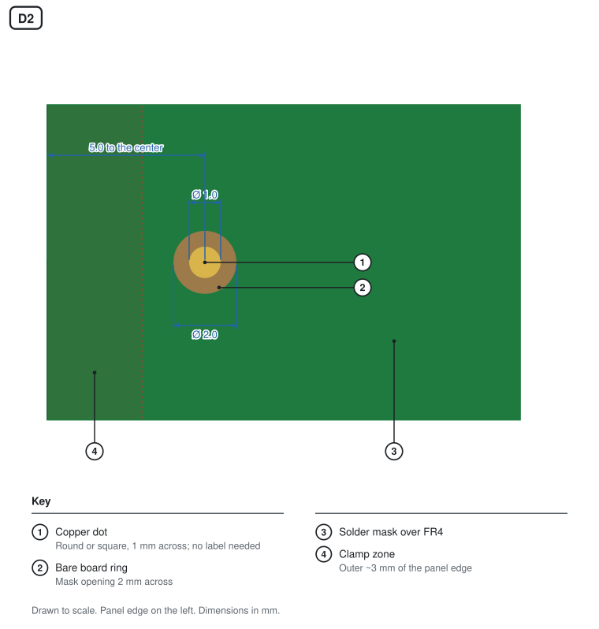
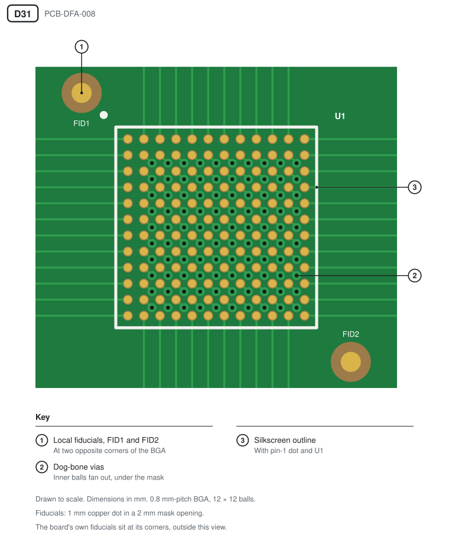

# Rails, tooling holes and fiducials

Machines carry a panel by its two long edges, so most panels get a strip of extra material along each one called a **rail**.
Rails give the conveyors and clamps something to hold.
They also carry the panel's **global fiducials** and, at some factories, its **tooling holes**, which locate it on pins.
Global fiducials are small copper targets the machines' cameras use to find exactly where the panel is.
It's beneficial for your board to have its own fiducials, but not essential if there is not enough real estate.
They cost about five minutes of design time and help every machine on the line.

*D1 is drawn to scale.
It shows a 140 × 110 mm panel of four boards, each 70 × 45 mm, in two rows of two.
A 10 mm rail runs along each long edge, parallel to the direction of travel.
Three global fiducials sit on the rails, one on the top rail and two on the bottom rail.
Each rail may also have a 3/16 in tooling hole near each end (many factories no longer use them).
Every board carries its own two fiducials near opposite corners.
Dashed V-score lines run edge to edge, separating the boards from each other and from the rails.*

## PCB-DFA-005: Expect rails along the long edges unless you design them out

**Recommendation:** Assume your assembler will add a rail of about 10 mm along each long edge of the panel and will put the global fiducials there.
If you can keep every component and exposed copper well clear of the board edges (see [PCB-DFA-015](04-edge-clearance.md#pcb-dfa-015-keep-parts-and-exposed-copper-at-least-3-mm-from-the-edges-5-mm-if-you-can)), tell your assembler: they may be able to skip the rails.

**Why:** Conveyors and machine clamps grip the board edge.
Rails give them a strip to hold that carries nothing of yours.
Skipping rails saves panel material and a depaneling step, but needs a board designed for it from the start.

**Typical values:** About 10 mm per rail is common.
For one assembler, 95–99 % of jobs need rails.
A large panel may also get a 10 mm rail down the middle so the reflow oven's center support has somewhere to sit.
Some assemblers, Worthington Assembly among them, put 10 mm rails on all four sides and between the boards, with the global fiducials on the short-edge rails (D48, [PCB-DFA-076](#pcb-dfa-076-make-each-fiducial-show-which-side-and-which-corner-it-is)).
Tooling holes in the rails are now largely a legacy feature: one assembler used 3/16 in (about 4.8 mm) holes for years and, as of 2026, has stopped using them altogether.
Others still use them, in various sizes.

**Example:** One designer laid out a 2 × 2 panel with no rails at all: edge clearances and fiducials designed in, nothing to break off, zero waste.

**Applies to:** Varies by manufacturer.
Check with yours.

**Sources:** [“How PCB panelization methods inform depanelization”](https://www.buzzsprout.com/1066066/episodes/11289685-how-pcb-panelization-methods-inform-depanelization) (Sep 2022), [19:00](https://www.buzzsprout.com/1066066/episodes/11289685?t=1140)–20:00 and [31:00](https://www.buzzsprout.com/1066066/episodes/11289685?t=1860); [“Small PCB layout decisions that have a significant impact on assembly”](https://www.buzzsprout.com/1066066/episodes/8957623-small-pcb-layout-decisions-that-have-a-significant-impact-on-assembly) (Aug 2021), [17:00](https://www.buzzsprout.com/1066066/episodes/8957623?t=1020)–23:00; [“What are fiducials and why you should use them”](https://www.buzzsprout.com/1066066/episodes/9355465-what-are-fiducials-and-why-you-should-use-them) (Oct 2021), [27:00](https://www.buzzsprout.com/1066066/episodes/9355465?t=1620)–28:00.

*Last reviewed: 2026-10-28*

---

## PCB-DFA-006: Make fiducials simple copper dots, round or square, with a clear ring around them

**Recommendation:** Make each fiducial a round copper dot 1 mm in diameter, with the solder mask pulled back to a circle 2 mm in diameter, so a 0.5 mm ring of bare board surrounds it.
You can use squares too.
But crosses and other shapes are less common.
A clever practice is to use rounds on the top side and squares on the bottom side.
Silkscreen labels are not necessary.

**Why:** Cameras need a high-contrast target.
Glossy solder mask next to the dot, especially white or yellow, reflects light and confuses them.
Modern vision systems don't need unusual shapes, and every assembler recognizes a plain dot as a fiducial.

**Typical values:** 1 mm dot · 2 mm mask opening.
Common industry practice.

**What goes wrong if you don't:** The machine can't find the board.
The operator has to teach it by hand, and placement accuracy can suffer.

**Applies to:** General practice.

**Sources:** [“What are fiducials and why you should use them”](https://www.buzzsprout.com/1066066/episodes/9355465-what-are-fiducials-and-why-you-should-use-them) (Oct 2021), [23:00](https://www.buzzsprout.com/1066066/episodes/9355465?t=1380)–26:00; [“Small PCB layout decisions that have a significant impact on assembly”](https://www.buzzsprout.com/1066066/episodes/8957623-small-pcb-layout-decisions-that-have-a-significant-impact-on-assembly) (Aug 2021), [27:00](https://www.buzzsprout.com/1066066/episodes/8957623?t=1620)–31:00.

*Last reviewed: 2026-10-28*

---

## PCB-DFA-007: Put at least two fiducials on each board, far apart, on every side that has surface-mount parts

**Recommendation:** Place two fiducials near opposite corners of the board itself, not only on the panel rails.
Use three on large boards.
If both sides of the board carry surface-mount parts, put fiducials on both sides.
Keep the center of every fiducial's copper dot about 5 mm in from the edge of the panel.

**Why:** Two fiducials give the machine position and rotation.
A third lets it correct for the board stretching or shrinking slightly.
Fiducials on the board itself mean it can still be built if it comes out of its panel, and an operator can fix a setup mistake at the machine without calling an engineer.
Most machines clamp the outer 3 mm or so of the panel edge, so any part of a fiducial inside that strip will probably be covered.

*D2.
The close-up is enlarged and drawn to scale.
A copper dot 1 mm in diameter sits in a solder mask opening 2 mm in diameter, leaving a 0.5 mm ring of bare board.
The outer 3 mm of the panel edge is shaded: that's where machine clamps grip.
The center of the copper dot is 5 mm in from the panel edge, so the clamps can't hide it.*

**Typical values:** 2 minimum, 3 preferred · center about 5 mm in from the panel edge; clamps cover the outer ~3 mm.
If the board runs without rails, its own edge is the panel edge, so give the fiducials more room: one rail-less design used about 10 mm.

**What goes wrong if you don't:** Most designs arrive without fiducials (about 19 out of 20 at one factory), so assemblers add them to the rails.
That works, but only while the board stays in its panel.

**Example:** A conveyor fault once broke a panel into its individual boards.
Because each board had its own fiducials, the machine was reprogrammed and the boards were built anyway.

**Applies to:** General practice.
Very small boards (about 10 × 15 mm) have been built successfully without fiducials by putting them in a panel.

**Sources:** [“What are fiducials and why you should use them”](https://www.buzzsprout.com/1066066/episodes/9355465-what-are-fiducials-and-why-you-should-use-them) (Oct 2021), [10:00](https://www.buzzsprout.com/1066066/episodes/9355465?t=600)–14:00, [17:00](https://www.buzzsprout.com/1066066/episodes/9355465?t=1020)–23:00, [26:00](https://www.buzzsprout.com/1066066/episodes/9355465?t=1560)–28:00 and [31:00](https://www.buzzsprout.com/1066066/episodes/9355465?t=1860); [“How to develop a PCBA functional test system w/ FixturFab”](https://www.buzzsprout.com/1066066/episodes/10100478-how-to-develop-a-pcba-functional-test-system-w-fixturfab) (Feb 2022), [01:07:00](https://www.buzzsprout.com/1066066/episodes/10100478?t=4020).

*Last reviewed: 2026-11-07*

---

## PCB-DFA-008: If there's room, add local fiducials beside expensive or very fine-pitch parts

**Recommendation:** If there's room and it's easy, add a pair of fiducials right beside high-value BGAs, very fine-pitch parts and dense clusters of very small parts, such as 0201 and 01005.
This is a low priority.
Leave them out if they get in the way of anything else on the board.

**Why:** Local fiducials let the placement machine re-check its position right at that part, instead of relying on fiducials far away across the panel.
But modern placement machines are accurate enough with the board's own fiducials.
They also use their own cameras to find each part's leads or balls before placing it.
So on most boards today, local fiducials add little.

**Example:** A board carrying a single FPGA worth about $6,000 has fiducials at the corners of the BGA.

*D31 is drawn to scale.
A pair of local fiducials just outside two opposite corners of the BGA lets the machine correct its position right where the accuracy matters.
Each is a 1 mm copper dot in a 2 mm mask opening.
The board's own fiducials sit at its corners, outside this view.*

**Applies to:** General practice.

**Sources:** [“What are fiducials and why you should use them”](https://www.buzzsprout.com/1066066/episodes/9355465-what-are-fiducials-and-why-you-should-use-them) (Oct 2021), [28:00](https://www.buzzsprout.com/1066066/episodes/9355465?t=1680)–30:00; Chris Denney (author).

*Last reviewed: 2026-11-12*

---

## PCB-DFA-009: Don't use drilled holes instead of fiducials

**Recommendation:** Use etched copper fiducials for machine alignment, even if the board already has tooling or mounting holes.

**Why:** Holes are drilled in a separate step from copper etching, so they never line up with the pads quite as precisely.
Fiducials are etched at the same moment as the pads they help place.

**Applies to:** General practice.

**Sources:** [“What are fiducials and why you should use them”](https://www.buzzsprout.com/1066066/episodes/9355465-what-are-fiducials-and-why-you-should-use-them) (Oct 2021), [19:00](https://www.buzzsprout.com/1066066/episodes/9355465?t=1140)–20:00.

*Last reviewed: 2026-10-28*

---

## PCB-DFA-076: Make each fiducial show which side and which corner it is

**Recommendation:** Give the panel three global fiducials of different sizes, 1, 2 and 3 mm, and make them round on the top side and square on the bottom side.
Put them on the rails at three corners: the 1 mm at one corner, and the 2 mm and 3 mm at the two ends of the opposite long edge.
Give each the clear ring of bare board described in [PCB-DFA-006](#pcb-dfa-006-make-fiducials-simple-copper-dots-round-or-square-with-a-clear-ring-around-them).

**Why:** A machine's camera finds each fiducial by its shape and size.
If every fiducial is the same, a panel loaded the wrong way round, or upside down, still shows the camera what it expects, and the machine prints or places on the wrong side or rotated by 180°.
With three sizes and a different shape on each side, the camera finds a 1 mm dot where it expected a 3 mm one, or a square where it expected a circle, and stops before anything is built.

**Typical values:** Copper dots 1, 2 and 3 mm, each in a solder mask opening about twice its size.
Round on the top side, square on the bottom.
At one assembler: on the short-edge rails, centered in the 10 mm rail and 15 mm from the long edges (D48).

*D48 is drawn to scale: a 150 × 110 mm panel of four 60 × 40 mm boards, with 10 mm rails on all four sides and between the boards, seen from the top and from the bottom.
On each side, three fiducials sit on the short-edge rails, centered in the rail and 15 mm from the long edges: 1 mm at the upper left, 2 mm at the lower left and 3 mm at the lower right.
They are round on the top side and square on the bottom side, as the enlarged row shows.
The rail along the long edge opposite the 2 and 3 mm fiducials carries "Top" or "Bottom" and the board's part number in silkscreen (PCB-DFA-077).*

**What goes wrong if you don't:** A panel loaded rotated or upside down that the machine accepts anyway: paste printed on the wrong side, or parts placed 180° out across the whole panel.

**Applies to:** Varies by assembler; this is Worthington Assembly's panel style.
Many assemblers design the panel themselves ([PCB-DFA-001](01-why-panels.md#pcb-dfa-001-let-your-manufacturer-design-the-panel-and-approve-it-before-you-order-bare-boards)); if yours does, ask for this.

**Sources:** Worthington Assembly Panel Design Guidelines v1.1; Chris Denney (author).

*Last reviewed: 2026-11-07*

---

## PCB-DFA-077: Print the board's part number and the side on the panel rails

**Recommendation:** Put the board's part number and the word "Top" or "Bottom" in silkscreen on a rail on each side of the panel.
At one assembler, both go on the long-edge rail opposite the 2 mm and 3 mm fiducials (D48).

**Why:** Anyone handling a panel, at any station, can see at a glance what board it is and which side is facing them.
That catches the wrong job on a machine, or a panel turned over, before it's built.

**What goes wrong if you don't:** Boards that look alike mixed up between jobs, or a panel run on the wrong side.

**Applies to:** Varies by assembler; this is Worthington Assembly's panel style.

**Sources:** Worthington Assembly Panel Design Guidelines v1.1; Chris Denney (author).

*Last reviewed: 2026-11-07*

---

## PCB-DFT-001: Give the board its own tooling holes if it will go into a test fixture

**Recommendation:** If the board will be tested in a fixture (for example a bed-of-nails or functional test fixture), include tooling holes on the board itself so the fixture can locate it.
Don't rely on the board outline.

**Why:** Tooling holes on the rails are gone once the board leaves the panel.
A routed edge is accurate to within about 0.1 mm, but a V-scored edge varies a lot more, so it's a poor reference for a fixture.

**Typical values:** There's no single standard, but one contract manufacturer's guide is a good starting point.
Make each tooling hole 3 mm to 4 mm in diameter.
A 2 mm hole is possible if you really need it.
Drill them to a tolerance of +0.05 mm, −0.0 mm, and don't plate them.
Use two holes per board, ideally in diagonally opposite corners, as far apart as you can, and at least 3 mm from the edge of the board.
Keep an area at least 5 mm in diameter around each hole free of parts and tracks on the underside, so the board sits flat and the tooling pins can't short anything.
Check the size and position with whoever builds the fixture.

**Applies to:** General practice.

**Sources:** [“How to develop a PCBA functional test system w/ FixturFab”](https://www.buzzsprout.com/1066066/episodes/10100478-how-to-develop-a-pcba-functional-test-system-w-fixturfab) (Feb 2022), [01:07:00](https://www.buzzsprout.com/1066066/episodes/10100478?t=4020); one contract manufacturer's technical paper, "Design guidelines for in-circuit testability" (2020).

*Last reviewed: 2026-11-10*

---

## Related pages
- [Why boards are built in panels](01-why-panels.md)
- [Clearance near board and panel edges](04-edge-clearance.md)

---
*From OpenDFX for Printed Circuit Boards by Chris Denney · CC BY-SA 4.0*
