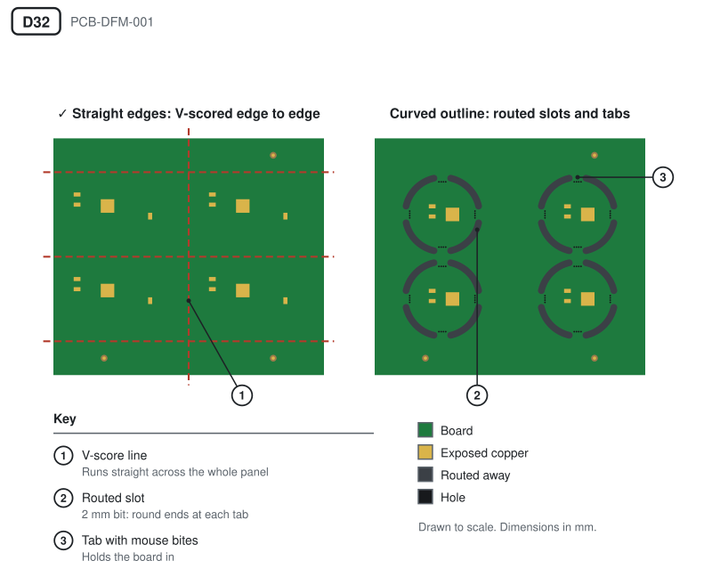
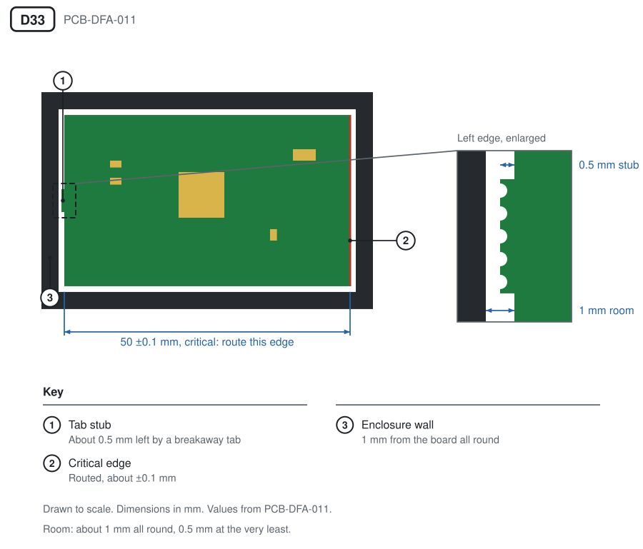
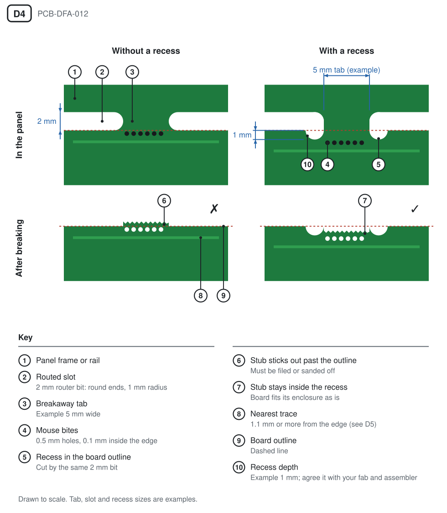
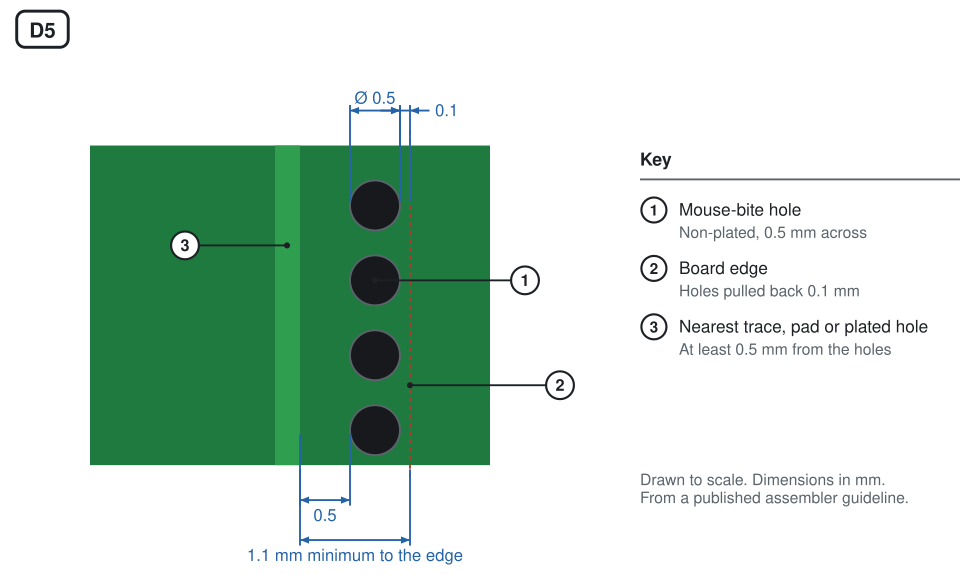

# Breakaway methods: V-score, tabs and mouse bites

After assembly, the boards have to come out of the panel.
There are two common ways to hold them in so they can be separated later:

- **V-score:** the fab cuts a V-shaped groove part-way through the board from both sides, in straight lines that run the full width of the panel.
  The boards are later separated by pushing a round knife along the groove or by snapping them by hand.
  Fast and cheap, but it only works on straight edges.
- **Tab routing:** the fab routes a slot around each board, leaving small tabs that hold it in place.
  Tabs with a row of small holes are called **mouse bites**, and they leave small stubs on the edge after breaking.
  Some assemblers have automated routers for depaneling these, leaving a clean edge.
  Though these machines are generally rare among most manufacturers.
  Ask your assembler about their capabilities.

| Feature | V-score | Tab routing (mouse bites) |
|---|---|---|
| Board shape | Straight edges only, scored edge to edge | Any shape |
| Cost | Lower | Higher (extra routing, slower to separate) |
| Edge finish | Clean, but less precise | Precise routed edge, with small stubs at each tab |
| Edge accuracy | Varies more | About ±0.1 mm on the routed parts |
| Typical tab width | Not applicable | About 3–6 mm |

Your design decides which one your assembler can use.

## PCB-DFM-001: Use straight-edged, rectangular board outlines when you can

**Recommendation:** Keep the board outline rectangular, or at least made of straight edges, unless the product really needs another shape.

**Why:** A straight-edged board can be V-scored, which is the cheaper and faster method.
Any curved or irregular edge forces tab routing, which needs a slower router pass and leaves stubs that may need filing or sanding.

*D32 is drawn to scale.
Rectangular boards are separated by V-score lines that run straight across the whole panel.
Round boards each need a routed slot all the way round and tabs with mouse bites to hold them in.*

**What goes wrong if you don't:** Higher board cost, slower depaneling, and manual finishing of the tab stubs.

**Applies to:** General practice.

**Sources:** [“PCB Depaneling”](https://www.buzzsprout.com/1066066/episodes/8035612-pcb-depaneling) (Mar 2021), [29:00](https://www.buzzsprout.com/1066066/episodes/8035612?t=1740); [“How PCB panelization methods inform depanelization”](https://www.buzzsprout.com/1066066/episodes/11289685-how-pcb-panelization-methods-inform-depanelization) (Sep 2022), [13:00](https://www.buzzsprout.com/1066066/episodes/11289685?t=780)–15:00; [“Small PCB layout decisions that have a significant impact on assembly”](https://www.buzzsprout.com/1066066/episodes/8957623-small-pcb-layout-decisions-that-have-a-significant-impact-on-assembly) (Aug 2021), [35:00](https://www.buzzsprout.com/1066066/episodes/8957623?t=2100)–40:00.

*Last reviewed: 2026-10-28*

---

## PCB-DFA-010: Keep overhanging parts away from breakaway edges, and draw the overhang on the silkscreen

**Recommendation:** Avoid connectors, antennas or modules that hang past the board edge on an edge that will be V-scored or tabbed.
Never put overhangs on opposite edges facing each other across the panel.
If an overhang is unavoidable, show its full outline on the silkscreen or assembly drawing so the panel designer can leave room.

**Why:** Separating a V-score means bending the panel along the groove, and an overhanging part blocks that bend.
The panel designer usually works from the board outline and won't read every datasheet; a visible outline makes them check and add a cut-out (relief) in the panel at that spot.

**Typical values:** Example: a coax connector overhanging by 7 mm needed about 10 mm of clearance.
Some fiber optic connectors overhang the edge by more than 1 in (25 mm).

*D24 is drawn to scale.
On the left, a coax connector on board A hangs 7 mm past the V-score, over board B.
The side view shows board B bent up to snap the score: it meets the underside of the connector before the score can break.
On the right, board A's edge is routed and held by tabs with mouse bites, and a routed relief cut-out leaves 10 mm from board A's edge.
The connector's silkscreen outline includes the part past the edge, so the panel designer can see it.*

*D25 is drawn to scale.
Two overhangs face each other across the score, one on each face of the panel.
Bending board B up drops its own connector onto board A; bending it down lands board B on board A's connector.
Each overhang blocks one direction, so together they block both, and the score can't be snapped.
Keep overhangs off breakaway edges, or route the edge and leave a relief cut-out, as in D24.*

**What goes wrong if you don't:** Panels that are nearly impossible to separate, parts snapped off during depaneling or shipping, and boards that have to be cut apart by hand.

**Example:** An ethernet port on the bottom of one board and a USB port on the top of its neighbor overlapped across the panel rail with no clearance.
The boards could not be separated without removing and re-soldering a part.
On another design, a module on top and a USB port directly beneath it pinched the panel material; hundreds of boards had to be cut free by hand.

**Applies to:** General practice.

**Sources:** [“How PCB panelization methods inform depanelization”](https://www.buzzsprout.com/1066066/episodes/11289685-how-pcb-panelization-methods-inform-depanelization) (Sep 2022), [15:00](https://www.buzzsprout.com/1066066/episodes/11289685?t=900)–17:00; [“How Loci Controls automates landfill methane gas collection”](https://www.buzzsprout.com/1066066/episodes/5509702-how-loci-controls-automates-landfill-methane-gas-collection) (Sep 2020), [01:11:00](https://www.buzzsprout.com/1066066/episodes/5509702?t=4260); [“The PCB CAM Process w/ Dave Wilcox”](https://www.buzzsprout.com/1066066/episodes/8226431-the-pcb-cam-process-w-dave-wilcox) (Mar 2021), [01:18:00](https://www.buzzsprout.com/1066066/episodes/8226431?t=4680)–01:20:00; [“An Answering Your Questions Grab Bag”](https://www.buzzsprout.com/1066066/episodes/13847902-an-answering-your-questions-grab-bag) (Oct 2023), [39:00](https://www.buzzsprout.com/1066066/episodes/13847902?t=2340)–40:00; [“How to safely and successfully ship assembled PCBs w/ Nicole Poirier”](https://www.buzzsprout.com/1066066/episodes/8309835-how-to-safely-and-successfully-ship-assembled-pcbs-w-nicole-poirier) (Apr 2021), [34:00](https://www.buzzsprout.com/1066066/episodes/8309835?t=2040)–36:00; [“What factors influence PCB quotes w/ Brett Babilonia”](https://www.buzzsprout.com/1066066/episodes/14580855-what-factors-influence-pcb-quotes-w-brett-babilonia) (Feb 2024), [32:00](https://www.buzzsprout.com/1066066/episodes/14580855?t=1920) and [41:00](https://www.buzzsprout.com/1066066/episodes/14580855?t=2460)–42:00.

*Last reviewed: 2026-10-28*

---

## PCB-DFA-011: Mark critical edges on a drawing, and leave room around the board in the enclosure

**Recommendation:** Don't draw the board to the exact inside size of its enclosure.
Leave about 1 mm all round (0.5 mm at the very least).
If an edge really must be held tightly, mark it as a critical dimension on a mechanical drawing so the assembler routes that edge instead of scoring or tabbing it.

**Why:** Even good fabs hold board edges to only about ±0.1 mm, and boards change size slightly through reflow and other heating steps.
A V-scored edge is less precise than a routed one, and tab stubs stick out past the edge.

**Typical values:** Fab edge tolerance about ±0.1 mm (routed) · enclosure clearance about 1 mm, 0.5 mm minimum.

*D33 is drawn to scale, with the left edge enlarged.
The board has about 1 mm of room all round inside its enclosure.
A breakaway tab can leave a stub of about 0.5 mm, which that room absorbs.
The one edge that must be held tightly is marked critical on the drawing, so the assembler routes it to about ±0.1 mm.*

**What goes wrong if you don't:** Boards that don't fit their case, or that need every tab stub filed off by hand.

**Applies to:** General practice.
Tighter tolerances may be possible but would need to be confirmed with the fab and assembler in advance.

**Sources:** [“Small PCB layout decisions that have a significant impact on assembly”](https://www.buzzsprout.com/1066066/episodes/8957623-small-pcb-layout-decisions-that-have-a-significant-impact-on-assembly) (Aug 2021), [32:00](https://www.buzzsprout.com/1066066/episodes/8957623?t=1920)–35:00; [“PCB Depaneling”](https://www.buzzsprout.com/1066066/episodes/8035612-pcb-depaneling) (Mar 2021), [34:00](https://www.buzzsprout.com/1066066/episodes/8035612?t=2040); [“How PCB panelization methods inform depanelization”](https://www.buzzsprout.com/1066066/episodes/11289685-how-pcb-panelization-methods-inform-depanelization) (Sep 2022), [29:00](https://www.buzzsprout.com/1066066/episodes/11289685?t=1740)–30:00.

*Last reviewed: 2026-10-28*

---

## PCB-DFA-012: If you need tabs and a clean outline, recess the edge where each tab joins

**Recommendation:** For a tab-routed board that must fit its enclosure closely, add a small notch in the board outline at each tab location.
Agree on the tab positions with your assembler.

**Why:** After breaking, the tab stub sits inside the notch, flush with the rest of the outline, so nobody has to file or sand it off.

*D4 is drawn to scale.
The top row shows the board in the panel: a 2 mm routed slot separates it from the panel frame, and a 5 mm tab bridges the slot, joined to the board by a row of 0.5 mm mouse-bite holes.
The bottom row shows the board after breaking.
Without a recess, the rough stub sticks out past the board outline and has to be filed off.
With a recess, the board outline steps 1 mm inward at the tab, so the stub stays below the outline and the board fits its enclosure as it is.
The tab, slot and recess sizes are examples.*

**Typical values:** Tabs are typically about 3–6 mm wide.
Mouse-bite holes are 0.5 mm non-plated holes, pulled back 0.1 mm from the board edge.
Keep traces, pads and plated holes at least 0.5 mm from the mouse-bite holes, which puts them at least 1.1 mm from the board edge.
One assembler's guideline.

*D5.
The close-up is enlarged and drawn to scale.
Non-plated holes 0.5 mm in diameter run along the board edge, each pulled back 0.1 mm from the edge.
The nearest trace, pad or plated hole is at least 0.5 mm from the holes, which puts it at least 1.1 mm from the board edge.*

**What goes wrong if you don't:** Every board needs its tab stubs filed, sanded or ground flush.
If your assembler does not have an automated depaneling router, then it's slow manual work, and you pay for it whether or not it's on the quote.

**Example:** A consumer product with a distinctive non-rectangular enclosure, ordered in the thousands.
The customer suggested recessing the edge at each tab instead of having every unit filed by hand.
The assembler now recommends it to other customers.

**Applies to:** General practice.

**Sources:** [“PCB Depaneling”](https://www.buzzsprout.com/1066066/episodes/8035612-pcb-depaneling) (Mar 2021), [14:00](https://www.buzzsprout.com/1066066/episodes/8035612?t=840); [“Small PCB layout decisions that have a significant impact on assembly”](https://www.buzzsprout.com/1066066/episodes/8957623-small-pcb-layout-decisions-that-have-a-significant-impact-on-assembly) (Aug 2021), [41:00](https://www.buzzsprout.com/1066066/episodes/8957623?t=2460)–47:00; [“Recessing Your PCB Edge for Perforated Tabs (mouse bites)”](https://www.worthingtonassembly.com/blog/2018/6/20/recessing-your-pcb-edge-for-perforated-tabs), Worthington Assembly blog (Jul 2021).

*Last reviewed: 2026-10-28*

---

## PCB-DFA-013: Agree the number and position of tabs on round or odd-shaped boards

**Recommendation:** For non-rectangular boards, decide with your assembler how many tabs to use and where they go.
Tell them about any keep-out areas, such as an antenna, where a tab must not be placed.

**Why:** Too few tabs and a large board can fall out of the panel during handling or reflow.
Too many, or in the wrong place, and separating the board risks damaging it.

**What goes wrong if you don't:** Example: a 6 in (about 150 mm) round board with only two tabs, which is clearly not enough to hold it securely.

**Applies to:** Varies by manufacturer.
Check with yours.

**Sources:** [“PCB Depaneling”](https://www.buzzsprout.com/1066066/episodes/8035612-pcb-depaneling) (Mar 2021), [33:00](https://www.buzzsprout.com/1066066/episodes/8035612?t=1980); [“Small PCB layout decisions that have a significant impact on assembly”](https://www.buzzsprout.com/1066066/episodes/8957623-small-pcb-layout-decisions-that-have-a-significant-impact-on-assembly) (Aug 2021), [41:00](https://www.buzzsprout.com/1066066/episodes/8957623?t=2460)–47:00.

*Last reviewed: 2026-10-28*

---

## PCB-DFA-014: Talk to your assembler before panelizing boards thicker than about 2 mm

**Recommendation:** If your board is 2 mm thick or more, discuss depaneling with your assembler before you order.

**Why:** Standard depaneling tools are made for boards around 1.6 mm thick.
Thicker boards are too stiff to snap cleanly along a score, and too thick for the usual round-blade cutter.

**Typical values:** 1.6–1.8 mm depanels normally · 2.0–2.4 mm and up gets difficult.

**What goes wrong if you don't:** If your assembler does not have an automatic depaneling router then boards are broken by hand or cut apart one at a time with special cutters.
That's slow, it adds labor cost, and the extra force puts parts near the edge at risk.

**Example:** Boards a quarter of an inch (about 6 mm) thick could not be separated by any normal method and had to be cut apart by hand with a rotary tool.

**Applies to:** General practice.

**Sources:** [“How PCB panelization methods inform depanelization”](https://www.buzzsprout.com/1066066/episodes/11289685-how-pcb-panelization-methods-inform-depanelization) (Sep 2022), [23:00](https://www.buzzsprout.com/1066066/episodes/11289685?t=1380)–25:00; [“An Answering Your Questions Grab Bag”](https://www.buzzsprout.com/1066066/episodes/13847902-an-answering-your-questions-grab-bag) (Oct 2023), [40:00](https://www.buzzsprout.com/1066066/episodes/13847902?t=2400)–41:00.

*Last reviewed: 2026-10-28*

---

## Related pages
- [Clearance near board and panel edges](04-edge-clearance.md)
- [Why boards are built in panels](01-why-panels.md)

---
*From OpenDFX for Printed Circuit Boards by Chris Denney · CC BY-SA 4.0*
