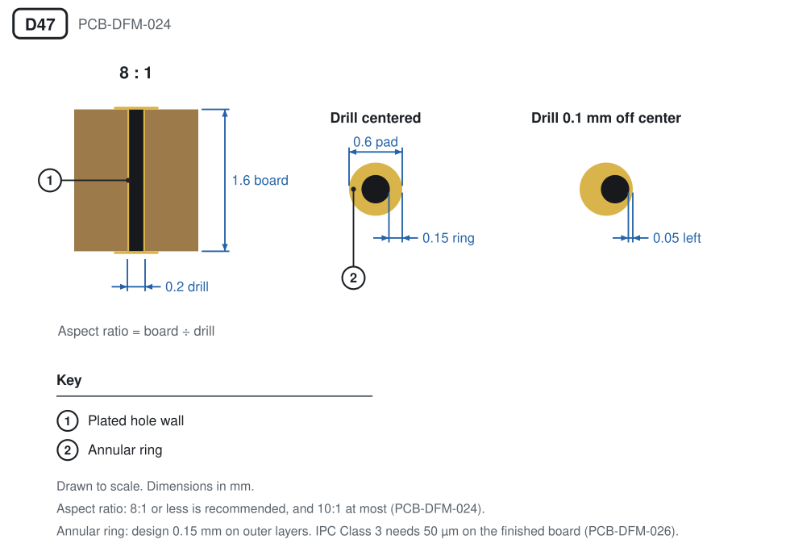

# Drilling

Every hole in a board is drilled after lamination: mechanically with carbide drill bits for most holes, or with a laser for the very small microvias in high-density boards.
Plated holes are then lined with copper, so the drill is always larger than the hole you end up with.
Small holes in thick boards are hard to drill straight and hard to plate all the way down, and every different hole size is another tool change.

How to describe holes in your data, and how to mark the ones that matter, is in [Fabrication data](../01-design-package/01-fabrication-data.md) (PCB-DFM-011 and PCB-DFM-012).

## PCB-DFM-023: Give hole sizes as finished sizes

**Recommendation:** Give every hole in your design as the finished size you need after plating and surface finish, not the size of drill you think the fab should use.

**Why:** The fab drills plated holes larger, by an amount that depends on its plating process, copper weight and finish, so that the finished hole comes out at your size.
They can only do that if your sizes are finished sizes.

**Typical values:** A 1.0 mm finished plated hole is typically drilled at about 1.1 to 1.15 mm.
One large fab enlarges plated holes of 0.5 mm and up by 0.15 mm, and non-plated holes by 0.05 mm.

**What goes wrong if you don't:** Holes too small for the leads, if you've already allowed for plating and the fab allows for it again.

**Applies to:** General practice.

**Sources:** [“The basics of the PCB drilling process w/ CAM Engineer Dave Wilcox”](https://www.buzzsprout.com/1066066/episodes/9091552-the-basics-of-the-pcb-drilling-process-w-cam-engineer-dave-wilcox) (Aug 2021), [17:00](https://www.buzzsprout.com/1066066/episodes/9091552?t=1020); one large fab's published hole-size guidance.

*Last reviewed: 2026-11-07*

---

## PCB-DFM-024: Keep the aspect ratio at 8:1 or less, and holes 0.25 mm or larger where you can

**Recommendation:** Keep the ratio of board thickness to the smallest plated hole's drill size at 8:1 or less, and no more than 10:1.
Use 0.25 mm (10 mil) or larger for the smallest drilled holes where the design allows, and avoid going below 0.2 mm.

**Why:** Plating solution has to flow all the way down a hole to plate its walls.
The deeper and narrower the hole, the harder that is, and the thinner the copper in the middle of the barrel.
Small drills also bend and break more easily, and fabs can't stack as many panels on the drill at once, which makes drilling slower and more expensive.

**Typical values:** (see D47)

| Aspect ratio (thickness : drill) | What it means |
|---|---|
| 8:1 or less | Recommended; any good fab |
| 8:1 to 10:1 | Possible; pushing the limits |
| Over 10:1 | Difficult; ask first |

For a 1.6 mm board, a 0.2 mm drill is 8:1.
At 0.25 mm, a fab can drill two 1.6 mm panels stacked together; some fabs can't drill below 0.2 mm at all.

*D47 is drawn to scale.
On the left, a 1.6 mm board with a 0.2 mm drilled hole: 1.6 ÷ 0.2 gives an aspect ratio of 8:1, the recommended limit.
On the right, a 0.6 mm pad on a 0.3 mm hole has a 0.15 mm annular ring all round when the drill is centered.
With the drill 0.1 mm off center, only 0.05 mm of ring is left on one side; the hole is still inside the pad, which is what the margin is for ([PCB-DFM-026](#pcb-dfm-026-give-every-plated-hole-an-annular-ring-with-margin-above-the-ipc-minimum)).*

**What goes wrong if you don't:** Thin or missing copper in the middle of the hole, which may pass electrical test and then crack open in thermal cycling.

**Applies to:** General practice; capability varies by fab.

**Sources:** [“Advanced Drilling w/ CAM Engineer, Dave Wilcox”](https://www.buzzsprout.com/1066066/episodes/10611991-advanced-drilling-w-cam-engineer-dave-wilcox) (May 2022), [38:00](https://www.buzzsprout.com/1066066/episodes/10611991?t=2280)–40:00; [“The basics of the PCB drilling process w/ CAM Engineer Dave Wilcox”](https://www.buzzsprout.com/1066066/episodes/9091552-the-basics-of-the-pcb-drilling-process-w-cam-engineer-dave-wilcox) (Aug 2021), [03:00](https://www.buzzsprout.com/1066066/episodes/9091552?t=180)–04:00; fabs' published capability tables (8:1 standard, 10:1 to 12:1 advanced).

*Last reviewed: 2026-11-07*

---

## PCB-DFM-025: Use as few different hole sizes as you can

**Recommendation:** Standardize on one or two via sizes, and avoid hole sizes that differ by only a few hundredths of a millimeter.

**Why:** Every hole size is another tool change on the drilling machine.
Near-duplicate sizes usually come from footprints made by different people, not from a real need.

**Typical values:** About 40 to 60 seconds per tool change, on every panel.

**What goes wrong if you don't:** Longer drilling time and a higher price for no benefit.

**Applies to:** General practice.

**Sources:** [“Advanced Drilling w/ CAM Engineer, Dave Wilcox”](https://www.buzzsprout.com/1066066/episodes/10611991-advanced-drilling-w-cam-engineer-dave-wilcox) (May 2022), [46:00](https://www.buzzsprout.com/1066066/episodes/10611991?t=2760)–49:00 and [55:00](https://www.buzzsprout.com/1066066/episodes/10611991?t=3300)–56:00.

*Last reviewed: 2026-11-07*

---

## PCB-DFM-026: Give every plated hole an annular ring with margin above the IPC minimum

**Recommendation:** Design every pad on a plated hole with an annular ring (the copper between the edge of the hole and the edge of the pad) of 0.15 mm or more on outer layers where you can.
Never end a trace at a plated hole without a pad.

**Why:** The drill never lands exactly in the center of the pad: layers move in the press, and the drill has its own tolerance.
The annular ring is the margin that keeps the hole inside the pad.
IPC-6012 sets what the finished board must meet; your design needs more than that, so the board still meets it after the drill wanders.

**Typical values:** Design target: 0.15 mm (6 mil) on outer layers; 0.125 mm is a common fab minimum for design; 0.2 mm or more for high-reliability products.
IPC-6012F, finished board, external plated holes:
- Class 2: the hole may break out of the pad by up to 90°, as long as the trace joining the pad isn't narrowed too far; with no teardrop, at least 25 µm of ring where the trace joins.
- Class 3: at least 50 µm of ring all round.

Internal layers, Class 3: at least 25 µm.
Teardrops (fillets where a trace meets a pad) are acceptable for Class 2 unless you prohibit them, and must be agreed for Class 3.

**What goes wrong if you don't:** Holes that break out of their pads, X-outs, and boards that fail Class 3 inspection.

**Applies to:** General practice.

**Sources:** IPC-6012F (Sept 2023), section 3.4.2 and Table 3-7; [“Advanced Drilling w/ CAM Engineer, Dave Wilcox”](https://www.buzzsprout.com/1066066/episodes/10611991-advanced-drilling-w-cam-engineer-dave-wilcox) (May 2022), [26:00](https://www.buzzsprout.com/1066066/episodes/10611991?t=1560)–28:00 and [35:00](https://www.buzzsprout.com/1066066/episodes/10611991?t=2100)–36:00; [“Inner Layer Production w/ CAM Engineer Dave Wilcox”](https://www.buzzsprout.com/1066066/episodes/9018673-inner-layer-production-w-cam-engineer-dave-wilcox) (Aug 2021), [01:03:00](https://www.buzzsprout.com/1066066/episodes/9018673?t=3780)–01:04:00; fabs' published annular ring guidance (0.125–0.15 mm).

*Last reviewed: 2026-11-07*

---

## PCB-DFM-027: Use microvias and blind or buried vias only when you need them

**Recommendation:** Use plain through-hole vias unless the design really needs blind, buried or micro vias (for example, to fan out a very fine-pitch BGA).
If you use laser microvias, make each one span a single layer (layer 1 to 2, for example), and stack them only if you must.

**Why:** Each blind or buried via structure adds drilling and lamination cycles.
A laser can only drill a hole about as deep as it is wide, so microvias reach only to the next layer, and need electroless copper plating to cover their walls.

**Typical values:** Laser microvias: below about 0.15 mm; depth about equal to diameter (0.1 mm wide, about 0.1 mm deep).

**What goes wrong if you don't:** A board that costs many times what it should.

**Example:** A design expected to cost $30–40 per board was quoted at hundreds of dollars, because it used stacked and blind vias and via fill it didn't need; removing them brought the price down sharply.

**Applies to:** General practice.

**Sources:** [“The basics of the PCB drilling process w/ CAM Engineer Dave Wilcox”](https://www.buzzsprout.com/1066066/episodes/9091552-the-basics-of-the-pcb-drilling-process-w-cam-engineer-dave-wilcox) (Aug 2021), [13:00](https://www.buzzsprout.com/1066066/episodes/9091552?t=780)–15:00; [“Understanding Controlled Impedance w/ NCAB Group Field Application Engineer, Ryan Miller”](https://www.buzzsprout.com/1066066/episodes/11631934-understanding-controlled-impedance-w-ncab-group-field-application-engineer-ryan-miller) (Nov 2022), [14:00](https://www.buzzsprout.com/1066066/episodes/11631934?t=840)–15:00; [“Outer Layer Imaging w/ CAM Engineer Dave Wilcox”](https://www.buzzsprout.com/1066066/episodes/11724857-outer-layer-imaging-w-cam-engineer-dave-wilcox) (Nov 2022), [18:00](https://www.buzzsprout.com/1066066/episodes/11724857?t=1080)–19:00.

*Last reviewed: 2026-11-07*

---

## Related pages
- [Fabrication data](../01-design-package/01-fabrication-data.md)
- [Plating](04-plating.md)
- [Via treatments](06-via-treatments.md)

---
*From OpenDFX for Printed Circuit Boards by Chris Denney · CC BY-SA 4.0*
