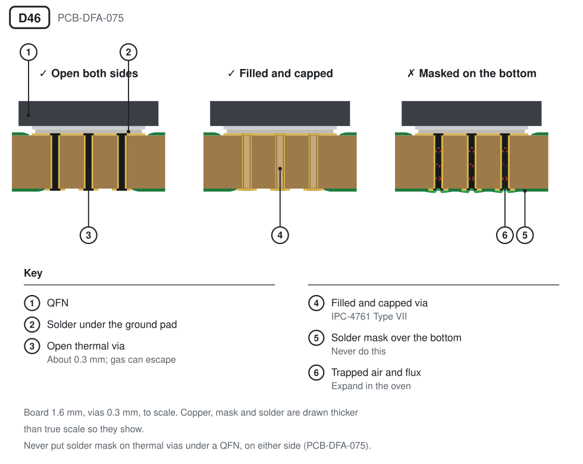

# Via treatments

A via is a plated hole that connects layers.
Left alone, it's an open hole lined with copper, with a ring of exposed copper on each side.
It can instead be covered with solder mask, partly or completely filled, or filled and plated over flat.
Each treatment changes what the via does during assembly, so choose it on purpose.

IPC-4761 names the treatments (drawn in D45):

| Type | Name | What it is |
|---|---|---|
| I | Tented | Solder mask laid over the via, covering its ring and its hole, on one side (Ia) or both (Ib) |
| II | Tented and covered | Tented, with a second coating over the mask; fabs describe a dry-film tent with a liquid mask coat over it. Rarely used |
| III | Plugged | Material pushed partway into the hole, from one side (IIIa) or both (IIIb); about a third of the depth from each side |
| IV | Plugged and covered | Plugged, then covered with mask |
| V | Filled | Hole completely filled, with non-conductive or conductive material |
| VI | Filled and covered | Filled, then covered with mask |
| VII | Filled and capped | Filled, then plated flat with copper, so a pad can sit on top |

*D45 shows a 0.3 mm via in a 1.6 mm board for each treatment, with copper and solder mask drawn thicker than true scale so they show.
The plating lines the hole and joins the pads on both surfaces and on two inner layers.
Solder mask goes on as a liquid and flows before it sets, so it is thickest on bare FR4, thinnest at the copper's corners, and sags where it spans a hole; the enlarged views at the bottom show this at true scale.
The first via is open, for comparison.
Type Ia is tented on one side only and is marked "avoid", because it traps air and chemistry.
Type II, a dry-film tent under a liquid coat, is rarely used.
Type III is plugged about a third of the way in from each side, leaving air in the middle; Type V is completely filled, flush with the pads; Type VII is filled and plated flat with copper.*

In this book, "tented" means IPC's Type I: mask over the ring and the hole.
Some designers and fabs also say "tented" when the mask covers the ring but leaves the hole open; if a fab's note or a design rule says "tent vias", check which they mean.

## PCB-DFM-030: Tent vias by default, on both sides, if they're 0.3 mm or smaller

**Recommendation:** Tent every via that doesn't need to be open, on both sides of the board, by leaving it out of the solder mask openings in your data.
Keep tented vias to 0.3 mm (12 mil) finished size or smaller; plug or fill larger ones.
Tent or plug vias under BGAs, and never leave an open via right beside a solder joint on a different net.

**Why:** A tented via can't steal solder from a nearby pad or bridge to it, lets legend print cleanly over it, and makes the board much easier to inspect.
Solder mask can only bridge a small hole; above about 0.3 mm it may not cover, or may crack as it cures.
Tenting one side only traps air and process chemistry in the hole (see [PCB-DFA-075](#pcb-dfa-075-never-put-solder-mask-on-thermal-vias-under-a-qfn)).
Tenting is not a seal: if air or liquid must not pass through, plug or fill the via instead.

**Typical values:** Tented: 0.3 mm or smaller, both sides.
Larger vias: plugged or filled.

**What goes wrong if you don't:** Solder bridges between a pad and a nearby open via; solder drawn away from joints; a busy board that's hard to inspect.

**Applies to:** General practice; check your fab's tenting limit.

**Sources:** [“Vias, Tenting, and Tiny Fireworks”](https://www.buzzsprout.com/1066066/episodes/15957877-vias-tenting-and-tiny-fireworks) (Oct 2024), [05:00](https://www.buzzsprout.com/1066066/episodes/15957877?t=300)–06:00 and [15:00](https://www.buzzsprout.com/1066066/episodes/15957877?t=900)–20:00; [“Small PCB layout decisions that have a significant impact on assembly”](https://www.buzzsprout.com/1066066/episodes/8957623-small-pcb-layout-decisions-that-have-a-significant-impact-on-assembly) (Aug 2021), [10:00](https://www.buzzsprout.com/1066066/episodes/8957623?t=600)–14:00; fabs' published via-tenting guidance (0.3 mm or smaller, both sides); Chris Denney (author).

*Last reviewed: 2026-11-07*

---

## PCB-DFM-031: Plug or fill vias that must be sealed, or that would trap chemistry

**Recommendation:** Plug or fill a via, rather than tent it, when air or liquid must not pass through the board, or when an open-on-one-side via could trap process chemistry (on boards with a gold finish, for example).
Say on the drawing which you want: plugged (partly filled from each side) or filled (completely).

**Why:** A tent is a thin film over a hollow hole; it isn't airtight.
A via left open on one side through fabrication can hold plating chemicals that spoil the gold finish nearby ("skip plating").
Plugged and filled are often used as if they meant the same thing, but a plugged via can still have an air gap in the middle.

**What goes wrong if you don't:** Leaks through the board where it must be sealed; patches of missing finish on pads.

**Example:** A gas-sensor maker used the board itself as the barrier between the gas being measured and the outside air, so every via had to be filled.
In testing, the fill wasn't strong enough to hold back the pressurized gas.
So the vias were left open, solder paste was printed over them along with the rest of the board, and reflow filled them with solder.
Filling vias with solder is rare, but here it stopped pressurized gas passing from one side of the board to the other.

**Applies to:** General practice.

**Sources:** [“Mastering Vias: Plugging, Filling, and Best Practices”](https://www.buzzsprout.com/1066066/episodes/16036518-mastering-vias-plugging-filling-and-best-practices) (Nov 2024), [02:00](https://www.buzzsprout.com/1066066/episodes/16036518?t=120)–06:00; [“Vias, Tenting, and Tiny Fireworks”](https://www.buzzsprout.com/1066066/episodes/15957877-vias-tenting-and-tiny-fireworks) (Oct 2024), [22:00](https://www.buzzsprout.com/1066066/episodes/15957877?t=1320)–23:00.

*Last reviewed: 2026-11-07*

---

## PCB-DFM-032: For via-in-pad, fill with non-conductive epoxy and plate over it

**Recommendation:** If a via sits inside a pad you'll solder to, specify it filled with non-conductive epoxy and copper-capped (IPC-4761 Type VII).
Use conductive fill only if you need its extra heat or current capacity and the volume justifies the cost; a larger via with standard fill is often enough.
Keep filled vias within your fab's size limit, and if many vias need filling, consider asking for all of them to be filled and capped.

**Why:** An open via in a pad drains solder from the joint and traps gas under the part.
Fill and cap gives a flat, solid pad.
A plugging compound (similar to solder mask) is fine for vias you won't solder to, but not under a cap.
Filling every via can be simpler and barely more expensive than choosing which ones.

**Typical values:** Filled vias up to about 0.5 mm (20 mil), depending on the fab.
IPC-6012F limits for a capped filled via: copper cap at least 5 µm (Class 2) or 12 µm (Class 3); dimple no deeper than 127 µm (Class 2) or 76 µm (Class 3); bump no higher than 50 µm.

**What goes wrong if you don't:** Voids and starved joints under fine-pitch parts and BGAs; with conductive fill, a higher price for little gain.

**Applies to:** General practice.

**Sources:** [“Mastering Vias: Plugging, Filling, and Best Practices”](https://www.buzzsprout.com/1066066/episodes/16036518-mastering-vias-plugging-filling-and-best-practices) (Nov 2024), [08:00](https://www.buzzsprout.com/1066066/episodes/16036518?t=480)–20:00; [“Vias, Tenting, and Tiny Fireworks”](https://www.buzzsprout.com/1066066/episodes/15957877-vias-tenting-and-tiny-fireworks) (Oct 2024), [16:00](https://www.buzzsprout.com/1066066/episodes/15957877?t=960)–17:00; IPC-6012F (Sept 2023), section 3.6.2.11.2 and Table 3-13.

*Last reviewed: 2026-11-07*

---

## PCB-DFA-075: Never put solder mask on thermal vias under a QFN

**Recommendation:** Never put solder mask on the thermal vias in a QFN's (or similar part's) ground pad, on either side of the board, and never plug them from one side only.
Leave them open on both sides, or have them filled and capped (IPC-4761 Type VII).
If a part's datasheet recommends tenting or plugging these vias from one side, the datasheet is wrong.
If some vias of the same size need a different treatment from the rest, flag them one by one in your design tool, or on a separate layer or note.

**Why:** The top of these vias is the pad you solder to, so it can't be tented.
Mask on the bottom closes the hole at one end.
In the oven, the air and flux trapped inside expand with nowhere to go: they blow voids into the joint, or lift the part right off the board.
Open vias let gas escape; filled and capped vias leave nothing to trap.
Many design tools only apply a via treatment by hole size, so a thermal via the same size as your ordinary vias gets tented with them unless you say otherwise.

**Typical values:** Open thermal vias: about 0.3 mm (as in D46).

*D46 shows a QFN soldered to its ground pad over three 0.3 mm thermal vias in a 1.6 mm board.
On the left, the vias are open on both sides, so gas can escape.
In the middle, they are filled and capped flat with copper, so there is nothing to trap.
On the right, solder mask covers the bottom of the vias; air and flux are trapped inside and expand in the oven.*

**What goes wrong if you don't:** Parts that come out of the oven displaced, or pop off the board during rework.

**Example:** A board's large QFN had thermal vias masked on the bottom and open on top.
The QFNs came out of reflow scattered, and when the assembler tried to rework them with hot air, they shot off the board like popcorn: the flux trapped in the vias was boiling.

**Applies to:** General practice.
One of the few places this book says "never".

**Sources:** [“Mastering Vias: Plugging, Filling, and Best Practices”](https://www.buzzsprout.com/1066066/episodes/16036518-mastering-vias-plugging-filling-and-best-practices) (Nov 2024), [00:30](https://www.buzzsprout.com/1066066/episodes/16036518?t=30)–03:00 and [21:30](https://www.buzzsprout.com/1066066/episodes/16036518?t=1290)–24:00; [“Vias, Tenting, and Tiny Fireworks”](https://www.buzzsprout.com/1066066/episodes/15957877-vias-tenting-and-tiny-fireworks) (Oct 2024), [20:00](https://www.buzzsprout.com/1066066/episodes/15957877?t=1200)–23:00; two semiconductor makers' QFN assembly notes (one warns that back-side tenting traps air and increases voiding); Chris Denney (author).

*Last reviewed: 2026-11-07*

---

## Related pages
- [Drilling](03-drilling.md)
- [Footprints and the component library](../01-design-package/04-footprints.md)
- [Reflow soldering](../05-assembly/03-reflow-soldering.md)

---
*From OpenDFX for Printed Circuit Boards by Chris Denney · CC BY-SA 4.0*
