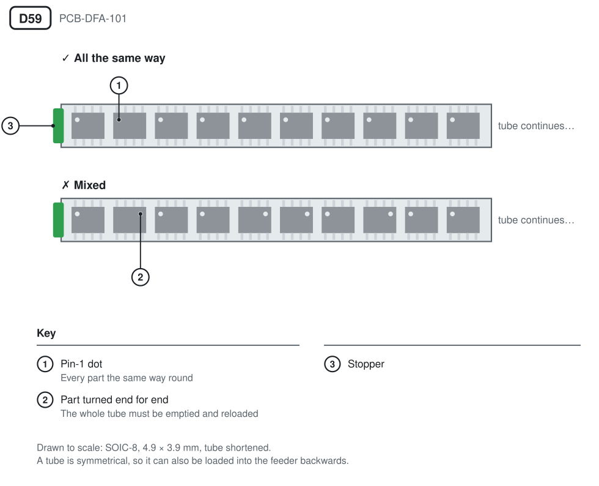

# Supplying your own parts (consignment) and spares

Most assemblers buy the parts for you ("turnkey").
Sometimes you'll supply some yourself ("consignment"): a part you already hold, one you've had to find from a special source, or a chip you've programmed.
Consigned parts arrive alongside dozens of other boxes and have to be identified, counted, matched to your job and loaded onto machines.
The more ready they are when they arrive, the faster and safer your build.

## PCB-DFA-100: Let your assembler buy the parts, and consign only the few you must

**Recommendation:** Let the assembler buy everything it can.
Consign only parts it can't get: ones you've secured in a shortage, special-source parts, or parts you program or modify yourself.
Don't consign resistors, capacitors and other common parts.
Ask before sending a full kit or bare boards; many assemblers don't accept them.

**Why:** Buying, receiving and kitting parts is an assembler's everyday work, done with barcodes and systems built for it.
A kit with parts from both you and the assembler on the same job is easy to mix up, especially across several orders.
Cheap parts aren't worth the handling, labeling and risk of sending them in.
Bare boards bought elsewhere may not suit the assembler's panel and handling needs ([PCB-DFA-001](../02-the-panel/01-why-panels.md)).

**What goes wrong if you don't:** Slower receiving, mix-ups between your parts and theirs, and a quick-turn job that's no longer quick.

**Example:** Before the 2021–22 shortage, about 80–90% of one assembler's builds had no consigned parts at all; during it, that roughly reversed.
Worthington Assembly and CircuitHub don't accept full consigned kits by default, and CircuitHub doesn't accept consigned bare boards.

**Applies to:** General practice; policies vary by assembler.
Holding stock for you between orders usually carries a fee.

**Sources:** [“How to Send Consigned Material to Your CM”](https://www.buzzsprout.com/1066066/episodes/10182930-how-to-send-consigned-material-to-your-cm) (Mar 2022), [09:00](https://www.buzzsprout.com/1066066/episodes/10182930?t=540)–13:00 and [49:00](https://www.buzzsprout.com/1066066/episodes/10182930?t=2940); [“All about parts purchasing - part 2”](https://www.buzzsprout.com/1066066/episodes/4704659-all-about-parts-purchasing-part-2) (Jul 2020), [38:00](https://www.buzzsprout.com/1066066/episodes/4704659?t=2280) and [40:00](https://www.buzzsprout.com/1066066/episodes/4704659?t=2400)–42:00; [“How Chinese New Year Impacts Manufacturing”](https://www.buzzsprout.com/1066066/episodes/9863955-how-chinese-new-year-impacts-manufacturing) (Jan 2022), [04:00](https://www.buzzsprout.com/1066066/episodes/9863955?t=240)–05:00; [“All the Tricks and Gotchas in Surface Mount Assembly (Repost from the Coriolis Effect)”](https://www.buzzsprout.com/1066066/episodes/11006453-all-the-tricks-and-gotchas-in-surface-mount-assembly-repost-from-the-coriolis-effect) (Jul 2022), [24:00](https://www.buzzsprout.com/1066066/episodes/11006453?t=1440)–27:00.

*Last reviewed: 2026-11-09*

---

## PCB-DFA-101: Send consigned parts ready for the machines

**Recommendation:** Send surface-mount parts in a form a machine can feed:
- reels, or cut tape in one continuous length per part number, not many short strips;
- no cut strip shorter than 50 mm, and preferably 150 mm or more;
- tubes only as a last resort, after reels, cut tape and trays are ruled out, and then with every part facing the same way;
- trays, or protective foam for tray parts, never loose in a bag.

Through-hole and hardware parts can come in labeled bags.

**Why:** Every strip has to be loaded into a feeder, or spliced onto the one before it, by hand.
A strip too short to reach through the feeder can't be loaded at all.
Cut tape nearly always arrives with a part in every pocket, and no empty leader, so the first and last part of each strip may be lost as it's loaded; the more strips, the more parts lost ([PCB-DFA-105](#pcb-dfa-105-send-spares-plenty-of-cheap-parts-at-least-one-of-each-expensive-one-and-say-when-you-cant)).
Assemblers like tubes less than any other packaging ([PCB-DFA-089](02-packaging.md)): they feed unreliably, hold few parts and can go in backwards.
A tube refilled with parts facing different ways has to be emptied and reloaded.
Loose surface-mount parts can't be machine-placed at all.

![D58: Drawn to scale, 8 mm carrier tape seen from above, with a part in every pocket. Top: one continuous strip 240 mm long, round sprocket holes along the top and the direction of feed to the right, so the right-hand end goes into the feeder first; 50 mm is marked as the shortest strip that can be handled and 150 mm as the preferred minimum, and the parts at both ends are marked as the ones that may be lost. Bottom: the same kind of parts sent as five strips of ten, each 40 mm long, shorter than the 50 mm minimum.](images/cut-tape-length.svg)

*D58 is drawn to scale.
Cut tape should come in strips of at least 50 mm, and preferably 150 mm or more; a strip of ten 0603 parts is only 40 mm long, and each one has to be handled separately.*

*D59 is drawn to scale, with the tubes shortened.
Every part in a tube must face the same way; a tube refilled with parts turned end for end has to be emptied and reloaded.*

**Typical values:** Shortest cut strip: 50 mm minimum, 150 mm or more preferred (Worthington Assembly and CircuitHub).
On 8 mm tape with a 4 mm pitch, 50 mm holds about 12 parts and 150 mm about 37.
1,000 parts sent in strips of ten means 100 strips to load or splice.

**What goes wrong if you don't:** Extra handling charges, lost parts, or parts that have to be fitted by hand.

**Example:** A customer sent addressable LEDs as strips of ten; the assembler charged a handling fee for every strip, to cover the time spent loading them.

**Applies to:** General practice.
EIA-481 sets leader and trailer lengths for full reels.

**Sources:** [“All about parts purchasing - part 2”](https://www.buzzsprout.com/1066066/episodes/4704659-all-about-parts-purchasing-part-2) (Jul 2020), [32:00](https://www.buzzsprout.com/1066066/episodes/4704659?t=1920)–34:00; [“How to Send Consigned Material to Your CM”](https://www.buzzsprout.com/1066066/episodes/10182930-how-to-send-consigned-material-to-your-cm) (Mar 2022), [36:00](https://www.buzzsprout.com/1066066/episodes/10182930?t=2160)–44:00; [“The RGB LED Dilemma in Manufacturing”](https://www.buzzsprout.com/1066066/episodes/15667846-the-rgb-led-dilemma-in-manufacturing) (Sep 2024), [13:00](https://www.buzzsprout.com/1066066/episodes/15667846?t=780)–14:00; [“All the Tricks and Gotchas in Surface Mount Assembly (Repost from the Coriolis Effect)”](https://www.buzzsprout.com/1066066/episodes/11006453-all-the-tricks-and-gotchas-in-surface-mount-assembly-repost-from-the-coriolis-effect) (Jul 2022), [24:00](https://www.buzzsprout.com/1066066/episodes/11006453?t=1440)–27:00; Chris Denney (author).

*Last reviewed: 2026-11-09*

---

## PCB-DFA-102: Ship consigned parts in static-shielding packaging, and moisture-sensitive ones sealed

**Recommendation:** Pack static-sensitive parts in static-shielding bags or boxes, not ordinary plastic bags or plain anti-static bags.
Send moisture-sensitive parts in their sealed moisture barrier bag, or resealed with fresh desiccant and a humidity card ([PCB-DFA-094](03-moisture-sensitive-parts.md)), and say on the packing slip that they're moisture-sensitive.

**Why:** Parts rattling in a plastic bag generate static, which can damage them before they reach the factory.
That damage often doesn't show in test; it surfaces as field failures months later, when the cause is hard to trace.
Parts that arrive with an open or badly resealed moisture bag have to be baked before use.

**What goes wrong if you don't:** Field failures nobody can explain, or a build delayed while parts are baked.

**Applies to:** General practice.

**Sources:** [“All about parts purchasing - part 2”](https://www.buzzsprout.com/1066066/episodes/4704659-all-about-parts-purchasing-part-2) (Jul 2020), [35:00](https://www.buzzsprout.com/1066066/episodes/4704659?t=2100)–38:00; [“How to Protect PCBs from ESD Damage”](https://www.buzzsprout.com/1066066/episodes/10275936-how-to-protect-pcbs-from-esd-damage) (Mar 2022), [22:00](https://www.buzzsprout.com/1066066/episodes/10275936?t=1320)–23:00; [“How to Manage Moisture Sensitive Devices”](https://www.buzzsprout.com/1066066/episodes/10522014-how-to-manage-moisture-sensitive-devices) (May 2022), [41:00](https://www.buzzsprout.com/1066066/episodes/10522014?t=2460)–42:00.

*Last reviewed: 2026-11-09*

---

## PCB-DFA-103: Label every package with its part number, and every shipment with your order details

**Recommendation:** On every bag, reel, tube and tray, put the maker's full part number (the original label is best; handwritten is fine).
On every shipment, put your company name, the assembler's order number and your purchase order number, and include a packing slip listing what's inside and which order it's for.
If one reel is shared between orders, say how to split it.
Send the tracking number as soon as you have it.
For a shipment from another country, ask the assembler first about duties, taxes and the product's end use.

**Why:** An assembler may receive about 100 boxes a day.
A box with no order reference waits until someone works out what it is, and the job waits with it.
A bag separated from its box needs its own label.
Import paperwork depends on what the product is for.
Unlabeled parts can hold a job up more than late ones: late parts are at least expected.

**What goes wrong if you don't:** A job held up, sometimes for days, while unlabeled parts are matched; leftovers that can't be returned with the right order.

**Applies to:** General practice.

**Sources:** [“All about parts purchasing - part 2”](https://www.buzzsprout.com/1066066/episodes/4704659-all-about-parts-purchasing-part-2) (Jul 2020), [32:00](https://www.buzzsprout.com/1066066/episodes/4704659?t=1920)–34:00; [“How to Send Consigned Material to Your CM”](https://www.buzzsprout.com/1066066/episodes/10182930-how-to-send-consigned-material-to-your-cm) (Mar 2022), [30:00](https://www.buzzsprout.com/1066066/episodes/10182930?t=1800)–31:00 and [35:00](https://www.buzzsprout.com/1066066/episodes/10182930?t=2100)–39:00 and [44:00](https://www.buzzsprout.com/1066066/episodes/10182930?t=2640)–48:00; [“Our top suggestions for customers w/ CircuitHub Account Manager, John Jacquinet”](https://www.buzzsprout.com/1066066/episodes/8884604-our-top-suggestions-for-customers-w-circuithub-account-manager-john-jacquinet) (Jul 2021), [29:00](https://www.buzzsprout.com/1066066/episodes/8884604?t=1740)–31:00; [“How to safely and successfully ship assembled PCBs w/ Nicole Poirier”](https://www.buzzsprout.com/1066066/episodes/8309835-how-to-safely-and-successfully-ship-assembled-pcbs-w-nicole-poirier) (Apr 2021), [30:00](https://www.buzzsprout.com/1066066/episodes/8309835?t=1800)–34:00.

*Last reviewed: 2026-11-09*

---

## PCB-DFA-104: Get consigned parts to the assembler at least the quoted assembly time before the ship date

**Recommendation:** Deliver consigned parts as early as you can.
At the latest, they should arrive as many working days before the ship date as the quoted assembly time.

**Why:** The line can't be set up until every part is there.
Most of a quoted lead time is preparation (buying, receiving, kitting, programming), not time on the line.
A job waiting for parts can be overtaken by jobs that are ready.

**Typical values:** For a 5-day assembly quote, parts at least 5 days before the ship date.
Of a 15–20 day lead time, about 15 days may be preparation and about 5 on the line.

**What goes wrong if you don't:** A missed ship date, often by more than the days the parts were late.

**Applies to:** General practice.

**Sources:** [“All about parts purchasing - part 2”](https://www.buzzsprout.com/1066066/episodes/4704659-all-about-parts-purchasing-part-2) (Jul 2020), [39:00](https://www.buzzsprout.com/1066066/episodes/4704659?t=2340)–40:00; [“How to Send Consigned Material to Your CM”](https://www.buzzsprout.com/1066066/episodes/10182930-how-to-send-consigned-material-to-your-cm) (Mar 2022), [17:00](https://www.buzzsprout.com/1066066/episodes/10182930?t=1020)–19:00.

*Last reviewed: 2026-11-09*

---

## PCB-DFA-105: Send spares: plenty of cheap parts, at least one of each expensive one, and say when you can't

**Recommendation:** Send more than the exact quantity: generous extra of small, cheap parts and at least one spare of each expensive part.
If you can only send the exact number (pre-release samples, very costly parts), say so clearly.
When the assembler buys for you, expect it to buy extra for the same reason.

**Why:** Machines reject parts they can't see clearly, lose some loading feeders, and drop parts when a nozzle clogs.
The smallest parts scatter easily: an inch of tape can hold 50–100 of them.
Cut tape usually has a part in every pocket, so the first and last part of each strip may be lost as it's loaded into a feeder.
A board short of one part can't ship.

**Typical values:** Minimum: one spare of every expensive part.
Recommended: about 10–20% extra on small, cheap parts (110–120 for 100 boards); a few percent extra on costly chips.
Assemblers buying for you typically add 2–3% on expensive parts and buy a full reel or more of cheap ones, since leftovers are usually scrapped.

**What goes wrong if you don't:** Boards missing a part, and a wait for more.

**Example:** About 100 extra 10 kΩ resistors for a job needing 2,010 cost under $1.
A customer sent a $5,000 FPGA with no spare and said so up front, which saved a round of emails.

**Applies to:** General practice.

**Sources:** [“How to Send Consigned Material to Your CM”](https://www.buzzsprout.com/1066066/episodes/10182930-how-to-send-consigned-material-to-your-cm) (Mar 2022), [13:00](https://www.buzzsprout.com/1066066/episodes/10182930?t=780)–17:00; [“All about parts purchasing - part 2”](https://www.buzzsprout.com/1066066/episodes/4704659-all-about-parts-purchasing-part-2) (Jul 2020), [06:00](https://www.buzzsprout.com/1066066/episodes/4704659?t=360); [“All the Tricks and Gotchas in Surface Mount Assembly (Repost from the Coriolis Effect)”](https://www.buzzsprout.com/1066066/episodes/11006453-all-the-tricks-and-gotchas-in-surface-mount-assembly-repost-from-the-coriolis-effect) (Jul 2022), [27:00](https://www.buzzsprout.com/1066066/episodes/11006453?t=1620)–28:00; [“An Answering Your Questions Grab Bag”](https://www.buzzsprout.com/1066066/episodes/13847902-an-answering-your-questions-grab-bag) (Oct 2023), [10:00](https://www.buzzsprout.com/1066066/episodes/13847902?t=600).

*Last reviewed: 2026-11-09*

---

## PCB-DFA-106: Tell your assembler before a substitute part number arrives

**Recommendation:** If you're sending a different part number from the one on the BOM, even an intended equivalent, tell the assembler before it arrives, and update the BOM.
When the assembler asks about a mismatch, answer quickly: have an engineer reachable during the build.

**Why:** A part that doesn't match the BOM stops the job until someone confirms it's right.
The assembler can't tell an intended substitute from a mistake.

**Typical values:** Aim to answer an assembler's question within about 30 minutes.

**What goes wrong if you don't:** A build stopped, or bumped behind other jobs, while a question waits.

**Example:** During the 2021–22 shortage, customers often sent substitutes with different part numbers; each unannounced one held its job until confirmed.

**Applies to:** General practice.

**Sources:** [“Showstoppers that delay PCB assembly w/ Production Manager, Rob OConnell”](https://www.buzzsprout.com/1066066/episodes/9741439-showstoppers-that-delay-pcb-assembly-w-production-manager-rob-oconnell) (Dec 2021), [19:00](https://www.buzzsprout.com/1066066/episodes/9741439?t=1140)–24:00.

*Last reviewed: 2026-11-09*

---

## Related pages
- [The BOM](../01-design-package/03-bom.md) (consigned and DNP lines: PCB-DFA-071)
- [Packaging: reels, cut tape, tubes, trays](02-packaging.md)
- [Moisture-sensitive parts](03-moisture-sensitive-parts.md)
- [Why panels](../02-the-panel/01-why-panels.md) (approve the panel before ordering boards: PCB-DFA-001)

---
*From OpenDFX for Printed Circuit Boards by Chris Denney · CC BY-SA 4.0*
