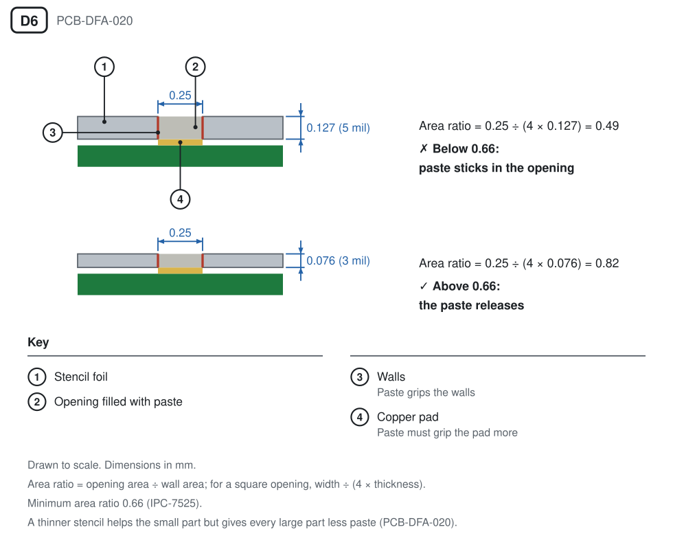

# Solder paste printing and stencils

Before any part is placed, solder paste is printed onto the board through a stencil: a thin steel sheet with an opening (an aperture) for every pad that needs solder.
A squeegee pushes paste across the stencil, the paste fills the apertures, and the stencil lifts away and leaves a small, measured deposit on each pad.
Most soldering defects start here, at printing, not later in placement or reflow.

The assembler designs the stencil, not you.
They choose its thickness, the shape and size of every aperture, and any special features, from the paste layer in your design files.
What your design controls is what they start from: which pads get paste, and how much the smallest and largest parts on the board pull the stencil in opposite directions.

## 5.2 Paste inspection, briefly

Many assemblers measure every paste deposit in 3D right after printing, before any part is placed.
A bad print is cleaned off and printed again, which is cheap; a bad print found after reflow is rework, which isn't.
There's nothing in your design that paste inspection needs, beyond the recommendations on this page.

## PCB-DFA-018: Send the paste layer 1:1 with your copper pads

**Recommendation:** Make each pad's paste opening the same size and shape as the copper pad.
Don't shrink, reshape or split paste openings yourself.
If a part needs something special, say so in a note on the assembly drawing.

**Why:** The assembler uses your paste layer as a map of where solder goes, then redraws every opening for their own stencil thickness, paste and process (for example, cutting a small notch out of the inner edge of each chip-resistor pad).
They assume your openings match the pads.
If you've already reduced them, they reduce them again, and the pads get too little solder.

**What goes wrong if you don't:** Starved joints, or a delay while the assembler works out what you meant.

**Applies to:** General practice.

**Sources:** [“Solder paste printing”](https://www.buzzsprout.com/1066066/episodes/5321710-solder-paste-printing) (Sep 2020), [01:03:00](https://www.buzzsprout.com/1066066/episodes/5321710?t=3780)–01:06:00; [“Stencils: The Unsung Heroes of PCB Perfection Pt.1”](https://www.buzzsprout.com/1066066/episodes/15448360-stencils-the-unsung-heroes-of-pcb-perfection-pt-1) (Jul 2024), [05:00](https://www.buzzsprout.com/1066066/episodes/15448360?t=300); [“Stencils: The Unsung Heroes of PCB Perfection Pt.
2”](https://www.buzzsprout.com/1066066/episodes/15484609-stencils-the-unsung-heroes-of-pcb-perfection-pt-2) (Jul 2024), [02:00](https://www.buzzsprout.com/1066066/episodes/15484609?t=120)–03:00.

*Last reviewed: 2026-11-01*

---

## PCB-DFA-019: Put paste on every pad you want soldered, and only those

**Recommendation:** Check the paste layer pad by pad before you release the design.
Remove paste from pads that must stay bare, such as test points.
The exception is a board with an OSP finish, where test points should get paste (see [PCB-DFT-008](../06-test-and-programming/01-test-points.md#pcb-dft-008-make-test-points-surface-mount-pads-at-least-09-mm-in-diameter-and-19-mm-apart-with-no-paste)).
Add paste where library footprints leave it out, such as surface-mount standoffs and some battery contacts.
For a surface-mount standoff, draw the paste openings the maker's datasheet shows; the assembler then adjusts them for its own stencil and the look you expect, often adding a lot more paste.

**Why:** The paste layer is the only place the assembler learns which pads get solder, and on which side of the board.
Footprints downloaded from part makers often have no paste data at all; a surface-mount standoff then looks like a plain mounting hole.

![D34: Drawn to scale except copper and mask thickness, after a maker's datasheet for an M3 surface-mount standoff 5 mm long, with the plated hole most boards use. Plan views of a 7.4 mm round pad around a 4.4 mm plated hole: with no paste in the footprint the pad stays bare; with the maker's stencil, a ring of paste from 4.48 to 7.27 mm in four segments covers it. Cut-away side views after reflow: the standoff's 6 mm body rests on the pad and its 4.2 mm locating collar drops into the hole. With no paste it sits loose; with paste, solder fills under the body, forms a fillet out to the pad's edge, and some drains down the hole round the collar.](images/standoff-paste.svg)

*D34 is drawn to scale, except copper and mask thickness, after a maker's datasheet for an M3 surface-mount standoff.
The footprint is a round copper pad around a plated hole, so without paste it looks like a through-hole pad and nothing solders the standoff.
With the maker's paste openings, a ring in four segments, reflow leaves solder under the standoff's body and a fillet round its base.
Some of the solder drains down the plated hole, which is one reason assemblers often print far more paste than the maker shows.*

**What goes wrong if you don't:** Solder on test points you meant to probe, or a standoff, battery contact or pogo pin soldered on the wrong side or not at all.
Assemblers catch many of these, but each catch is a question and a delay.

**Example:** Boards were shipped with solder on every test point.
The paste layer asked for it, so that's what was built.
The assembler now asks about test points on every new job.

**Applies to:** General practice.

**Sources:** [“Solder paste printing”](https://www.buzzsprout.com/1066066/episodes/5321710-solder-paste-printing) (Sep 2020), [01:04:00](https://www.buzzsprout.com/1066066/episodes/5321710?t=3840)–01:06:00; [“Stencils: The Unsung Heroes of PCB Perfection Pt.1”](https://www.buzzsprout.com/1066066/episodes/15448360-stencils-the-unsung-heroes-of-pcb-perfection-pt-1) (Jul 2024), [06:00](https://www.buzzsprout.com/1066066/episodes/15448360?t=360)–08:00.

*Last reviewed: 2026-11-01*

---

## PCB-DFA-020: Don't put one very fine-pitch part on a board of large parts

**Recommendation:** Keep the range of part sizes on one side of the board as narrow as you can.
If the board needs one very fine-pitch part (0.4 mm pitch or finer), try to put it on the opposite side from the large, solder-hungry parts (see [PCB-DFA-024](03-reflow-soldering.md)).

**Why:** One stencil prints every pad on a side, and its thickness is set mostly by the smallest openings.
Large parts want a thick stencil and plenty of paste; fine-pitch parts need a thin one, or the paste won't release from their tiny openings.
With both on one side, the assembler has to compromise: a thinner stencil that starves the large parts, or a stepped stencil (thicker or thinner in local patches), a special coating or finer paste, all of which cost more and take longer.

**Typical values:** Stencil thickness about 5 mil (0.13 mm) for most boards, 6 mil for boards of mostly large parts, about 4 mil once 0.4 mm-pitch parts or 0.5 mm-pitch BGAs appear (one assembler's practice).
The paste must release from each opening: the opening's area divided by the area of its walls (the area ratio) should be at least 0.66, and a rectangular opening's width at least 1.5 times the stencil thickness (IPC-7525).
Below about 0.66 the assembler needs a coated or stepped stencil; below about 0.60, bigger changes.
The paste must also fit: at least five of its largest grains across the narrowest opening, which pushes very small openings to finer, costlier paste.

*D6 is enlarged and drawn to scale.
It shows two cross-sections through a stencil opening 0.25 mm square, sitting over a copper pad.
In a 0.127 mm (5 mil) stencil, the area ratio is 0.25 ÷ (4 × 0.127) = 0.49, below the 0.66 minimum, so the paste grips the opening's walls more than the pad and stays in the stencil.
In a 0.076 mm (3 mil) stencil, the same opening has an area ratio of 0.82, and the paste releases onto the pad.
A thinner stencil helps the small part, but gives every other part on that side less paste.*

**What goes wrong if you don't:** A pricier stencil with a longer lead time, more defects on either the small part or the large ones, and a higher assembly price.

**Applies to:** General practice.
Exact thresholds vary by assembler, stencil and paste.

**Sources:** [“Solder paste printing”](https://www.buzzsprout.com/1066066/episodes/5321710-solder-paste-printing) (Sep 2020), [46:00](https://www.buzzsprout.com/1066066/episodes/5321710?t=2760) and [52:00](https://www.buzzsprout.com/1066066/episodes/5321710?t=3120)–53:00; [“Stencils: The Unsung Heroes of PCB Perfection Pt.1”](https://www.buzzsprout.com/1066066/episodes/15448360-stencils-the-unsung-heroes-of-pcb-perfection-pt-1) (Jul 2024), [18:00](https://www.buzzsprout.com/1066066/episodes/15448360?t=1080)–20:00 and [27:00](https://www.buzzsprout.com/1066066/episodes/15448360?t=1620)–30:00; [“Stencils: The Unsung Heroes of PCB Perfection Pt.
2”](https://www.buzzsprout.com/1066066/episodes/15484609-stencils-the-unsung-heroes-of-pcb-perfection-pt-2) (Jul 2024), [08:30](https://www.buzzsprout.com/1066066/episodes/15484609?t=510)–11:00 and [16:30](https://www.buzzsprout.com/1066066/episodes/15484609?t=990)–21:00; [“To BGA or Not to BGA”](https://www.buzzsprout.com/1066066/episodes/19944540-to-bga-or-not-to-bga) (Oct 2026), [22:30](https://www.buzzsprout.com/1066066/episodes/19944540?t=1350); IPC-7525C, stencil design guidelines (area ratio and aspect ratio); a solder paste maker's guidance on the "five-ball rule" (checked Oct 2026).

*Last reviewed: 2026-11-01*

---

## Related pages
- [Component placement](02-component-placement.md)
- [Reflow soldering](03-reflow-soldering.md)

---
*From OpenDFX for Printed Circuit Boards by Chris Denney · CC BY-SA 4.0*
