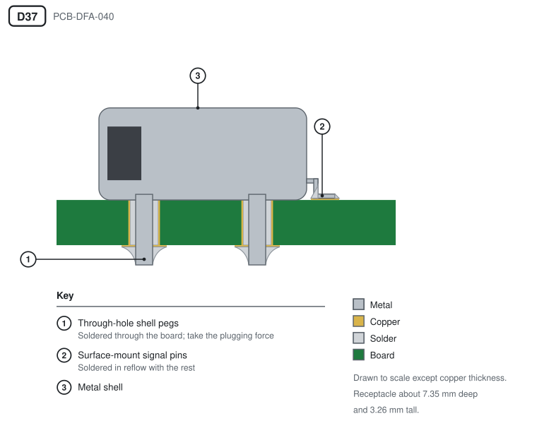

# Through-hole soldering

A through-hole part has leads or pins that pass through plated holes in the board.
They are soldered in one of four ways: in the reflow oven with the surface-mount parts, using paste printed into and around the holes (pin-in-paste, also called intrusive soldering); by a selective soldering machine, which brings a small fountain of molten solder to each pin from underneath; by a wave soldering machine, which passes the whole underside over a wave of solder; or by hand.
Every method except pin-in-paste is an extra step after reflow, and hand soldering is the slowest and least consistent.

What your design controls is how many through-hole parts there are, which parts they are, and how much room they have.

## PCB-DFA-039: Use surface mount by default, and through-hole only where a part takes force

**Recommendation:** Choose surface-mount parts wherever they'll do the job.
Keep through-hole, or hybrid parts (see [PCB-DFA-040](#pcb-dfa-040-prefer-hybrid-parts-surface-mount-signals-with-through-hole-pegs)), for parts that are pushed, pulled or twisted sideways often, or by people who don't know the product.

**Why:** Surface-mount parts are placed and soldered by machine in the same pass as everything else.
Through-hole parts need a separate soldering step, and loose axial and radial parts (resistors, capacitors) often need their leads bent and trimmed by hand first.
A through-hole joint is stronger against sideways force, so the failure point becomes the part itself, not its solder joint.

**Typical values:** One assembler's rule of thumb:

| Usually surface mount | Usually through-hole or hybrid |
|---|---|
| Resistors, capacitors, inductors, LEDs, crystals, ICs | Connectors that untrained people plug and unplug, such as field-wired terminal blocks |
| Ribbon-cable connectors; terminal blocks wired once inside a machine | Plugs used thousands of times, such as a phone's charging port |
| Low-voltage DC power jacks plugged in rarely | Mains (AC) power connectors |
| Coin-cell clips changed every few years | Holders for batteries changed every week |
| Push buttons, DIP switches, reset switches (the force is into the board) | On/off toggle switches used often (the force is sideways) |
| Trimmers set once at the factory | Volume and gain knobs that users turn |
| Power transistors and regulators, cooled through the board's copper | |

Where an enclosure holds a connector firmly (with nuts and bolts, for example), a surface-mount connector is usually fine.

**What goes wrong if you don't:** You pay for an extra soldering step, often by hand, for parts that didn't need it, or a connector tears off the board in use.

**Applies to:** General practice.

**Sources:** [“When to use through hole vs surface mount components”](https://www.buzzsprout.com/1066066/episodes/8803410-when-to-use-through-hole-vs-surface-mount-components) (Jul 2021), [10:00](https://www.buzzsprout.com/1066066/episodes/8803410?t=600)–39:00; [“Benefits of intrusive soldering”](https://www.buzzsprout.com/1066066/episodes/10791130-benefits-of-intrusive-soldering) (Jun 2022), [04:00](https://www.buzzsprout.com/1066066/episodes/10791130?t=240)–05:00; [“What factors influence PCB quotes w/ Brett Babilonia”](https://www.buzzsprout.com/1066066/episodes/14580855-what-factors-influence-pcb-quotes-w-brett-babilonia) (Feb 2024), [33:00](https://www.buzzsprout.com/1066066/episodes/14580855?t=1980)–39:00.

*Last reviewed: 2026-11-04*

---

## PCB-DFA-040: Prefer hybrid parts: surface-mount signals with through-hole pegs

**Recommendation:** Where a connector needs strength, look for a hybrid version: surface-mount signal pins, with through-hole pegs or pins that hold it to the board.
USB-C connectors are a common example.

**Why:** The pegs take the force of plugging and unplugging; the signal pins only carry signals.
Because the whole part can be soldered with pin-in-paste in the reflow oven, it needs no separate soldering step, and the pegs locate it so it can't be fitted crooked or backwards.
Some hybrid connectors have half their signal pins as through-holes, which can be routed on inner layers.

*D37 is drawn to scale, except copper thickness.
The shell's pegs are soldered through the board and take the force of plugging and unplugging.
The signal pins are surface-mount and solder in reflow with everything else.*

**Applies to:** General practice.
On a double-sided board, put hybrid parts on the side built second ([PCB-DFA-024](03-reflow-soldering.md)).

**Sources:** [“When to use through hole vs surface mount components”](https://www.buzzsprout.com/1066066/episodes/8803410-when-to-use-through-hole-vs-surface-mount-components) (Jul 2021), [10:00](https://www.buzzsprout.com/1066066/episodes/8803410?t=600)–11:00; [“The importance of having different perspectives in engineering w/ Eli Hughes of Tzero Labs (Part 2)”](https://www.buzzsprout.com/1066066/episodes/7118017-the-importance-of-having-different-perspectives-in-engineering-w-eli-hughes-of-tzero-labs-part-2) (Jan 2021), [40:00](https://www.buzzsprout.com/1066066/episodes/7118017?t=2400)–42:00; [The Best USB-C Port](https://www.worthingtonassembly.com/the-usbc-port) (Worthington Assembly).

*Last reviewed: 2026-11-04*

---

## PCB-DFA-041: Leave room around pin-in-paste parts for extra paste

**Recommendation:** Around any through-hole part that will be soldered in the reflow oven, leave a few millimeters clear of other parts, so the assembler can print extra paste onto the solder mask around the holes.
Check the board thickness the part's maker recommends: some hybrid connectors are designed for boards no thicker than about 1.3 mm.

**Why:** Solder paste is only about half metal by volume, so even a hole packed full of paste gives about half a hole of solder.
The assembler makes up the difference by printing paste well beyond the hole onto the mask, sometimes several millimeters; when it melts, it's all drawn into the hole.
Parts placed right up against the connector leave no room for it.

**Typical values:** Overprinting of up to about 5–8 mm beyond the hole has been used.
Joints soldered this way often look incompletely filled from the far side, but can still meet IPC-A-610J (Table 7-4).
It asks for at least 75% vertical fill for Class 2 and Class 3.
For Class 2 only, 50% or 1.2 mm, whichever is less, is enough on parts with 14 or more leads, and on a lead tied to an internal plane if the solder has wetted all the way round the lead and barrel on the side the solder came from.
It also notes that a pin-in-paste joint may have no fillet between the lead and the land.

*D18 is drawn to scale, except copper thickness.
Paste is printed well beyond the pad, onto the solder mask, because only about half of it is metal.
When it melts, it is drawn into the hole, filling it round the pin with a fillet on each side, and leaves only flux residue behind.*

**What goes wrong if you don't:** Holes without enough solder, or a second print pass and extra cost to get it there.

**Applies to:** General practice.

**Sources:** [“Benefits of intrusive soldering”](https://www.buzzsprout.com/1066066/episodes/10791130-benefits-of-intrusive-soldering) (Jun 2022), [14:00](https://www.buzzsprout.com/1066066/episodes/10791130?t=840)–17:00 and [26:00](https://www.buzzsprout.com/1066066/episodes/10791130?t=1560)–28:00.

*Last reviewed: 2026-11-04*

---

## PCB-DFA-042: Choose through-hole parts rated for the soldering process they'll see

**Recommendation:** Check that each through-hole part's plastic is rated for the way it will be soldered: reflow temperatures for pin-in-paste, and selective or wave soldering for the others.
Avoid hobby-grade and unverified parts in production; their plastics are often designed for hand soldering only.

**Why:** Selective and wave soldering heat plastics far more than a hand soldering iron does.
High-temperature plastics cost more, so cheap parts often use plastics that soften or melt.

**What goes wrong if you don't:** Melted connector housings, and a build switched to slow hand soldering.

**Applies to:** General practice.
Batteries are always soldered by hand ([PCB-DFA-026](03-reflow-soldering.md)).

**Sources:** [“The selective soldering process”](https://www.buzzsprout.com/1066066/episodes/7337971-the-selective-soldering-process) (Jan 2021), [41:00](https://www.buzzsprout.com/1066066/episodes/7337971?t=2460)–43:00; [“Benefits of intrusive soldering”](https://www.buzzsprout.com/1066066/episodes/10791130-benefits-of-intrusive-soldering) (Jun 2022), [29:00](https://www.buzzsprout.com/1066066/episodes/10791130?t=1740)–30:00.

*Last reviewed: 2026-11-04*

---

## PCB-DFA-043: Keep surface-mount parts away from through-hole pins on the solder side

**Recommendation:** On the side where through-hole pins come out (the side the solder is applied from), keep surface-mount pads 3 mm from the outer edge of each through-hole pad, and 5 mm on the side where the board leaves the solder wave (ask your assembler which side that is).
2 mm is the absolute minimum; more room is always better.
Keep small parts especially well away from pins that will be soldered by hand.

**Why:** A selective soldering machine's nozzle needs room around each pin; the smaller the nozzle the board forces, the harder and slower the job.
Too close, and the pins have to be soldered by hand.

**Typical values:** Absolute minimum 2 mm · recommended 3 mm · 5 mm on the side where the board leaves the wave · 4–5 mm all round makes the job easy (one assembler).
One selective-soldering machine maker gives 2 mm on three sides of a pin or row of pins and 5 mm on the side leaving the wave as its minimum, with a nozzle at least 3 mm in inside diameter.
A second maker's minimum is 1.5 mm from the soldered area to the nearest surface-mount pad for a single pin, and 2 mm for a row of pins, with a 6 mm standard nozzle.
If 2 mm isn't possible on three sides, the same maker suggests aligning nearby surface-mount parts in line with the pins.

*D17 is drawn to scale and shows the solder side.
The white dashed line is the recommended keep-out: 3 mm from the outer edge of the pads, and 5 mm on the side where the board leaves the wave.
The red dashed line is the 2 mm absolute minimum.
The surface-mount part outside it points at the pins rather than lying side-on to them.*

**What goes wrong if you don't:** Every board soldered by hand: higher cost, longer lead time and less consistent joints.

**Example:** A board had small diodes placed between its through-hole pins, so every pin had to be soldered by hand.
On the next revision the diodes were moved, and the boards went through the factory on the selective soldering machine: cheaper, faster and better soldered.

**Applies to:** General practice.
Nozzle sizes vary by assembler; check with yours.

**Sources:** [“The selective soldering process”](https://www.buzzsprout.com/1066066/episodes/7337971-the-selective-soldering-process) (Jan 2021), [47:00](https://www.buzzsprout.com/1066066/episodes/7337971?t=2820)–50:00; [“Showstoppers that delay PCB assembly w/ Production Manager, Rob OConnell”](https://www.buzzsprout.com/1066066/episodes/9741439-showstoppers-that-delay-pcb-assembly-w-production-manager-rob-oconnell) (Dec 2021), [33:00](https://www.buzzsprout.com/1066066/episodes/9741439?t=1980)–35:00; [Effects of an Appropriate PCB Layout and Soldering Nozzle Design on Quality and Cost Structure in Selective Soldering Processes](https://www.electronics.org/system/files/technical_resource/E8%26S23_02.pdf) (IPC technical paper, PDF); a second selective-soldering machine maker's layout recommendations (2017).

*Last reviewed: 2026-11-04*

---

## PCB-DFA-044: Use thermal relief on through-hole pads connected to planes

**Recommendation:** Connect through-hole pads to copper pours and planes with thermal relief (a few thin spokes), not solid copper.
Use thermal relief on every layer the pad connects to, inner layers as well as outer ones.

**Why:** A plane is a heat sink.
A surface-mount part on a plane still gets hot enough in the reflow oven, but a selective nozzle, a wave or a soldering iron can't put heat into a pad faster than a solid plane draws it away.

*D19 is drawn to scale.
In both views the plane is under the solder mask; only the pad's opening is bare.
Joined to the plane all round, the pad loses heat to it as fast as the soldering tool supplies it.
With thermal relief, four thin spokes across a clearance ring keep the heat in the joint.*

**Typical values:** Longer, narrower spokes keep more heat in the joint (a selective-soldering machine maker's guidance).

**What goes wrong if you don't:** Cold, poorly filled joints that look bad and may be weak, especially on big connectors and multilayer ground pours.

**Applies to:** General practice.

**Sources:** [“Showstoppers that delay PCB assembly w/ Production Manager, Rob OConnell”](https://www.buzzsprout.com/1066066/episodes/9741439-showstoppers-that-delay-pcb-assembly-w-production-manager-rob-oconnell) (Dec 2021), [34:00](https://www.buzzsprout.com/1066066/episodes/9741439?t=2040)–39:00; [“The selective soldering process”](https://www.buzzsprout.com/1066066/episodes/7337971-the-selective-soldering-process) (Jan 2021), [50:00](https://www.buzzsprout.com/1066066/episodes/7337971?t=3000)–51:00; a selective-soldering machine maker's layout recommendations (2017).

*Last reviewed: 2026-11-04*

---

## PCB-DFA-045: Match through-hole lead length to the board and the pitch

**Recommendation:** Choose through-hole parts whose leads suit your board's thickness: most parts assume a 1.6 mm board.
On fine-pitch through-hole connectors (about 1.27 mm pitch and finer), avoid leads that stick out a long way.
If leads must be bent or formed, show the bend angle and direction on the assembly drawing.

**Why:** Leads too short for the board don't come through to be soldered; leads too long on a fine-pitch connector bridge to each other in selective soldering.
Parts with other lead lengths exist, but often have to be special-ordered.

**Typical values:** For single-nozzle selective soldering, leads sticking out about 1 mm; for multi-nozzle dip soldering, more than 2.5 mm (a selective-soldering machine maker's guidance).

*D38 is drawn to scale, except copper thickness.
About 1 mm of lead through the board gives a full fillet and suits single-nozzle selective soldering.
A lead that ends inside the hole leaves no fillet on the solder side.
At fine pitch, long leads hold solder between them, and it bridges against the board.*

**What goes wrong if you don't:** Bridged pins, leads trimmed by hand, or parts that can't be soldered.

**Example:** A design called for a 1.2 mm board, then used hybrid parts with leads made for 1.6 mm boards on both sides.
After the first side was built, the leads stuck out through the other side, so that side's stencil couldn't lie flat to print.
Later builds used the same connectors with 1.2 mm leads, made for that board thickness.

**Applies to:** General practice.

**Sources:** [“The selective soldering process”](https://www.buzzsprout.com/1066066/episodes/7337971-the-selective-soldering-process) (Jan 2021), [43:00](https://www.buzzsprout.com/1066066/episodes/7337971?t=2580)–45:00; [“An Answering Your Questions Grab Bag”](https://www.buzzsprout.com/1066066/episodes/13847902-an-answering-your-questions-grab-bag) (Oct 2023), [42:00](https://www.buzzsprout.com/1066066/episodes/13847902?t=2520)–43:00; [“Showstoppers that delay PCB assembly w/ Production Manager, Rob OConnell”](https://www.buzzsprout.com/1066066/episodes/9741439-showstoppers-that-delay-pcb-assembly-w-production-manager-rob-oconnell) (Dec 2021), [29:00](https://www.buzzsprout.com/1066066/episodes/9741439?t=1740)–31:00; [Effects of an Appropriate PCB Layout and Soldering Nozzle Design on Quality and Cost Structure in Selective Soldering Processes](https://www.electronics.org/system/files/technical_resource/E8%26S23_02.pdf) (IPC technical paper, PDF).

*Last reviewed: 2026-11-04*

---

## PCB-DFA-046: Choose through-hole parts that hold themselves in place

**Recommendation:** Prefer through-hole parts that snap in or otherwise hold themselves in place.
Avoid top-heavy right-angle parts, and parts that must sit at an angle or perfectly flush, unless you've agreed with your assembler how they'll be held.

**Why:** A part that drops loosely into its holes can tilt or lift while it's soldered.
Holding it needs either a person or custom tooling.

**Typical values:** A handful of boards can be held and soldered by hand; thousands justify custom tooling; a few hundred is the hardest quantity, too many for hand work and too few for tooling.

*D39 shows the same connector twice, before soldering.
Its housing reaches past the board edge, so most of its weight is in front of its pins.
With snap-in pegs it stays flat through soldering with no tooling; without them it tips forward and lifts its pins unless someone or something holds it.*

**What goes wrong if you don't:** Crooked parts, tooling charges, or slow hand work.

**Applies to:** General practice.

**Sources:** [“Custom tooling to the rescue”](https://www.buzzsprout.com/1066066/episodes/10804740-custom-tooling-to-the-rescue) (Jul 2022), [26:00](https://www.buzzsprout.com/1066066/episodes/10804740?t=1560)–27:00; [“The selective soldering process”](https://www.buzzsprout.com/1066066/episodes/7337971-the-selective-soldering-process) (Jan 2021), [45:00](https://www.buzzsprout.com/1066066/episodes/7337971?t=2700)–46:00.

*Last reviewed: 2026-11-04*

---

## Related pages
- [Reflow soldering](03-reflow-soldering.md)
- [Press-fit and mechanical parts](06-press-fit-and-mechanical.md)

---
*From OpenDFX for Printed Circuit Boards by Chris Denney · CC BY-SA 4.0*
