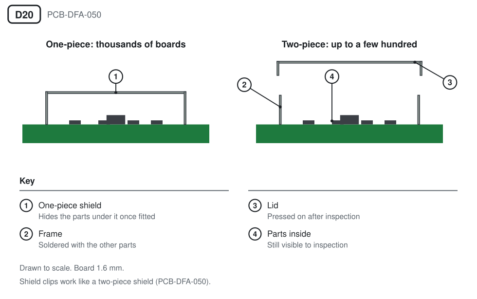
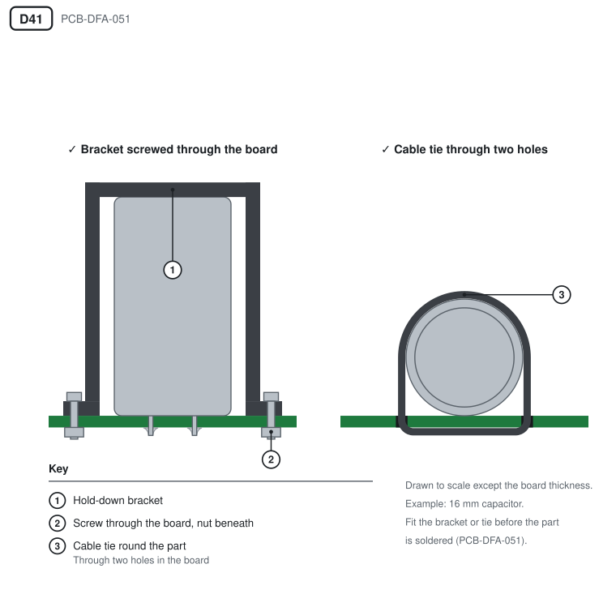

# Shields, adhesives and underfill

Some boards need more than solder.
RF shields are small metal cans soldered over sensitive circuits.
Adhesives hold heavy parts against vibration, or mount parts such as dome switches that have no solder joints.
Underfill is a liquid, usually epoxy, run under a BGA and cured, to lock it to the board against shock.

Each of these is an extra step, often done by hand, and not every assembler offers all of them.
What your design controls is which of them you need, and which version you choose.

## PCB-DFA-050: Choose a two-piece or clip-on RF shield for low volumes, and a one-piece shield for high volumes

**Recommendation:** For builds of up to a few hundred boards, use a two-piece shield (a frame soldered to the board and a separate lid) or shield clips, if you can afford them.
For thousands of boards, use a one-piece shield, and agree with your assembler how it will be handled before production.

**Why:** A one-piece shield hides everything under it as soon as it's on, so it has to go on after the parts beneath it are soldered and inspected.
That means either a second print, place and reflow pass, or hand soldering.
With a two-piece shield or clips, the frame is placed and soldered with everything else, the parts inside can still be inspected, and the lid goes on at the end.
A one-piece shield costs less to buy and, once the process is set up, is fully automated.

**Typical values:** Two-piece or clips: about 5 to 100 boards · one-piece: thousands (one assembler's guidance).

*D20 is drawn to scale.
On the left, a one-piece shield: a closed metal can soldered over small parts, which hides them from inspection once it's on.
On the right, a two-piece shield: an open frame soldered with the other parts, so the parts inside can still be inspected, and a lid pressed on at the end.
Shield clips work the same way as a two-piece shield.*

**What goes wrong if you don't:** Extra handling and cost at low volume, or a delay while the assembler works out how to build a one-piece shield.

**Applies to:** Varies by manufacturer.
Check with yours.

**Sources:** [“RF Shields and Restroom Rants”](https://www.buzzsprout.com/1066066/episodes/15565134-rf-shields-and-restroom-rants) (Aug 2024), [09:00](https://www.buzzsprout.com/1066066/episodes/15565134?t=540)–20:00.

*Last reviewed: 2026-11-04*

---

## PCB-DFA-051: Hold heavy parts down against vibration, and fit the hold-down before soldering

**Recommendation:** If heavy through-hole parts (large capacitors, batteries) must survive vibration, hold them to the board with something other than their solder joints.
The most secure options use hardware: a hold-down bracket (injection-molded or 3D-printed) with screws through it and through holes in the board, and nuts on the other side; or a cable tie passed through two holes in the board and around the part.
High-strength foam tape or room-temperature-curing (RTV) silicone also work.
Plan the holes in your layout, fit screws, brackets and ties before the part is soldered, and agree the method with your assembler before you order.

**Why:** A heavy part shaking on its leads fatigues its solder joints until they crack.
A hold-down carries the part's weight so the joints don't have to.
Fitted before soldering, it leaves the joints free of strain ([PCB-DFA-048](06-press-fit-and-mechanical.md)).
Ordinary double-sided tape isn't strong or stable enough.

*D41 is drawn to scale, except the board thickness.
A bracket screwed through the board, or a cable tie through two holes, carries the part's weight under vibration instead of its solder joints.
Plan the holes in the layout, and fit the bracket or tie before the part is soldered.*

**What goes wrong if you don't:** Joints that crack in the field, or an assembler who doesn't have the material or process.

**Applies to:** Varies by manufacturer.
Check with yours.

**Sources:** [“Alternative Component Mounting”](https://www.buzzsprout.com/1066066/episodes/10030215-alternative-component-mounting) (Feb 2022), [53:00](https://www.buzzsprout.com/1066066/episodes/10030215?t=3180)–57:00; the author's own experience of screwed hold-downs and cable ties.

*Last reviewed: 2026-11-04*

---

## PCB-DFA-052: Check part numbers so you don't order glue-mounted parts by mistake

**Recommendation:** Check the full part number of every ceramic capacitor and similar chip part to make sure it's the solder-mounted version.
If your design really needs parts mounted with conductive epoxy, ask your assembler before you design them in.

**Why:** Some chip parts come in versions with terminations made for epoxy mounting, and the part numbers can differ by a single character.
Most assemblers, Worthington Assembly and CircuitHub included, choose not to offer epoxy mounting.

**What goes wrong if you don't:** Parts that won't solder properly, found at assembly, and a wait for the right parts.

**Applies to:** General practice.

**Sources:** [“Alternative Component Mounting”](https://www.buzzsprout.com/1066066/episodes/10030215-alternative-component-mounting) (Feb 2022), [11:00](https://www.buzzsprout.com/1066066/episodes/10030215?t=660)–18:00.

*Last reviewed: 2026-11-04*

---

## PCB-DFA-053: Expect adhesive-mounted dome switches to need tooling

**Recommendation:** If your design uses dome switches held by an adhesive sheet, plan for the tooling, and check that your assembler will take the job at your quantity.

**Why:** The adhesive sheet is usually die-cut to match your board's switch positions, which means custom tooling before the first board.

**What goes wrong if you don't:** A tooling charge you didn't plan for, or a low-volume job declined.

**Applies to:** Varies by manufacturer.
Check with yours.

**Sources:** [“Alternative Component Mounting”](https://www.buzzsprout.com/1066066/episodes/10030215-alternative-component-mounting) (Feb 2022), [41:00](https://www.buzzsprout.com/1066066/episodes/10030215?t=2460)–44:00.

*Last reviewed: 2026-11-04*

---

## PCB-DFA-054: Consider underfill or corner bonding for BGAs in products that take repeated shock

**Recommendation:** If the product will take heavy, repeated shock (mining equipment, for example), consider underfill under its BGAs, or corner bonding (adhesive at the BGA's corners only), and agree the process with your assembler.

**Why:** Repeated shock fatigues the solder balls under a BGA.
Underfill fills the gap under the part and locks it to the board, so the balls don't carry the whole load.

*D42 is drawn to scale.
Underfill fills the whole gap under the package, round every ball.
Corner bonding puts a bead of adhesive at each of the four corners; it wicks a little way under the package and leaves the rest of the gap open.*

**What goes wrong if you don't:** BGA joints that crack in service.

**Applies to:** Varies by manufacturer.
Check with yours.

**Sources:** [“IPC APEX EXPO Meetup Recap”](https://www.buzzsprout.com/1066066/episodes/15044769-ipc-apex-expo-meetup-recap) (May 2024), [15:00](https://www.buzzsprout.com/1066066/episodes/15044769?t=900)–16:00.

*Last reviewed: 2026-11-04*

---

## Related pages
- [Press-fit and mechanical parts](06-press-fit-and-mechanical.md)
- [Cleaning](08-cleaning.md)

---
*From OpenDFX for Printed Circuit Boards by Chris Denney · CC BY-SA 4.0*
