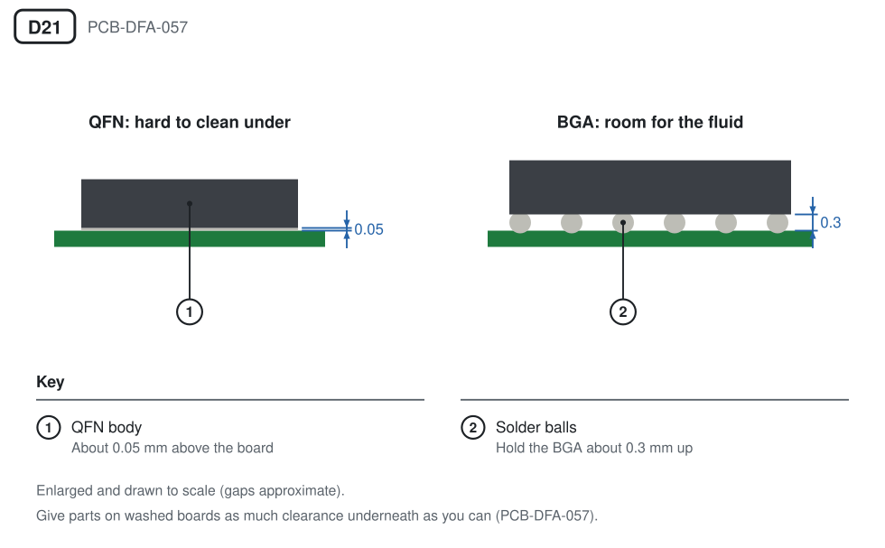

# Cleaning

Every soldering process uses flux, and flux leaves residue.
Most boards today are built with no-clean flux, whose residue is designed to be left on the board: once properly heated it is harmless, and it isn't a coating.
Boards built with water-soluble flux, and boards that need to be especially clean, are washed after soldering, usually in batch or conveyor machines with a cleaning chemical, then rinsed.

Cleaning is a reliability process, not a cosmetic one.
Residue becomes a problem when moisture, a conductive residue and a voltage all come together, which can grow metal between conductors (electrochemical migration).
A board cleaned badly can be less reliable than one not cleaned at all.

## PCB-DFA-055: Use no-clean flux unless your product needs cleaning, and say so if it does

**Recommendation:** Build with no-clean flux and no washing unless your product needs it.
If it does (high reliability, high impedance, high voltage, harsh environments, or conformal coating), say so explicitly when you order; don't assume the assembler will clean.

**Why:** For most designs, no-clean residue is safe once it's properly heated during soldering.
Cleaning adds a process step with its own risks, and many assemblers run no-clean as standard and send cleaning to a specialist.
Some designs need it anyway: residue matters more in high-impedance circuits, at high voltages, on very small and dense boards, and in wearable, outdoor and other harsh uses, even for an inexpensive product.

**Typical values:** Cleaning is for high-reliability uses such as aerospace, medical implants and other life-critical systems, high-voltage designs (hundreds of volts and up), and dense boards in harsh environments.
How clean is "clean enough" is no longer a single pass-or-fail number: J-STD-001 now asks for objective evidence that the process is clean enough for the product, usually from surface insulation resistance (SIR) testing; ionic-contamination (ROSE) testing is a process monitor, and means little on no-clean boards.

**What goes wrong if you don't:** Boards that need cleaning shipped uncleaned, or a cleaning step you didn't need, paid for and added risk to.

**Applies to:** General practice.
Whether an assembler cleans in house varies; check with yours.

**Sources:** [“Solder paste printing”](https://www.buzzsprout.com/1066066/episodes/5321710-solder-paste-printing) (Sep 2020), [12:00](https://www.buzzsprout.com/1066066/episodes/5321710?t=720); [“The role of flux in PCB assembly”](https://www.buzzsprout.com/1066066/episodes/10791051-the-role-of-flux-in-pcb-assembly) (Jun 2022), [22:00](https://www.buzzsprout.com/1066066/episodes/10791051?t=1320)–28:00; [“Even Cleaner Cleaning With Cleaning Expert Mike “Mr.
Clean” Konrad”](https://www.buzzsprout.com/1066066/episodes/11995563-even-cleaner-cleaning-with-cleaning-expert-mike-mr-clean-konrad) (Jan 2023), [11:00](https://www.buzzsprout.com/1066066/episodes/11995563?t=660)–17:00 and [37:00](https://www.buzzsprout.com/1066066/episodes/11995563?t=2220)–46:00; [“Board Cleaning w/ Mike Konrad (part 1)”](https://www.buzzsprout.com/1066066/episodes/8399139-board-cleaning-w-mike-konrad-part-1) (Apr 2021), [33:00](https://www.buzzsprout.com/1066066/episodes/8399139?t=1980); J-STD-001 (cleanliness requirements).

*Last reviewed: 2026-11-04*

---

## PCB-DFA-056: If a product works with no-clean, don't add cleaning or change the flux without a reason

**Recommendation:** If your boards are built with no-clean flux and aren't failing from residue, keep the process as it is.
If you do add cleaning, add it as an extra step, and keep the same flux and soldering profile.

**Why:** The existing process is already qualified by its record.
Changing the flux and adding cleaning at the same time changes two things at once, and a new cleaning step done poorly can leave a board less reliable than before.

**What goes wrong if you don't:** New failures, from a change made to fix a problem you didn't have.

**Applies to:** General practice.

**Sources:** [“Board Cleaning w/ Mike Konrad (part 1)”](https://www.buzzsprout.com/1066066/episodes/8399139-board-cleaning-w-mike-konrad-part-1) (Apr 2021), [33:00](https://www.buzzsprout.com/1066066/episodes/8399139?t=1980)–42:00; [“Even Cleaner Cleaning With Cleaning Expert Mike “Mr.
Clean” Konrad”](https://www.buzzsprout.com/1066066/episodes/11995563-even-cleaner-cleaning-with-cleaning-expert-mike-mr-clean-konrad) (Jan 2023), [01:09:00](https://www.buzzsprout.com/1066066/episodes/11995563?t=4140)–01:12:00.

*Last reviewed: 2026-11-04*

---

## PCB-DFA-057: Design boards that need cleaning so the fluid can get underneath

**Recommendation:** On a board that will be washed, give parts as much clearance underneath as you can, especially bottom-terminated parts such as QFNs.
Keep a solder mask dam around their pads ([PCB-DFA-032](../01-design-package/04-footprints.md)).

**Why:** Cleaning fluid has to reach under each part and be rinsed out again.
A QFN sits only a couple of thousandths of an inch (about 0.05 mm) above the board, which is very hard to clean under; a BGA's balls leave a much bigger gap.
At very high volumes, some makers go further and design so the board never needs cleaning: mask dams, controlled spacing and controlled voltages between conductors.

*D21 is enlarged and drawn to scale; the gaps are approximate.
On the left, a QFN sits on its soldered pads only about 0.05 mm above the board, leaving almost no room for cleaning fluid.
On the right, a BGA's solder balls hold it about 0.3 mm above the board, leaving a gap the fluid can reach and rinse.*

**What goes wrong if you don't:** Residue trapped under parts that the wash can't reach.

**Applies to:** General practice.

**Sources:** [“Board Cleaning w/ Mike Konrad (part 2)”](https://www.buzzsprout.com/1066066/episodes/8488862-board-cleaning-w-mike-konrad-part-2) (May 2021), [52:00](https://www.buzzsprout.com/1066066/episodes/8488862?t=3120)–54:00; [“Board Cleaning w/ Mike Konrad (part 1)”](https://www.buzzsprout.com/1066066/episodes/8399139-board-cleaning-w-mike-konrad-part-1) (Apr 2021), [33:00](https://www.buzzsprout.com/1066066/episodes/8399139?t=1980)–34:00.

*Last reviewed: 2026-11-04*

---

## PCB-DFA-058: Flag parts that can't be washed, and don't wash rigid-flex boards with chemicals

**Recommendation:** If a board will be washed, list any parts that mustn't get wet, so the assembler can mask them or fit them after washing.
Ask for rigid-flex boards not to be cleaned with chemicals.

**Why:** Washing gets everywhere.
Parts that can't take it have to be masked, or soldered by hand after the wash, which the assembler can only plan for if they know.
Chemical cleaning can damage the materials that join the rigid and flexible parts of a rigid-flex board.

**What goes wrong if you don't:** Damaged parts, or a rigid-flex board that comes apart.

**Example:** A rigid-flex board cleaned with chemicals was ruined.

**Applies to:** General practice.

**Sources:** [“How New Solder Products Are Developed w/ AIM Solder Content Marketing Specialist, Gayle Towell”](https://www.buzzsprout.com/1066066/episodes/14215618-how-new-solder-products-are-developed-w-aim-solder-content-marketing-specialist-gayle-towell) (Jan 2024), [36:00](https://www.buzzsprout.com/1066066/episodes/14215618?t=2160)–37:00; [“Flex & Rigid-Flex PCB Assembly”](https://www.buzzsprout.com/1066066/episodes/19401881-flex-rigid-flex-pcb-assembly) (Jun 2026), [12:00](https://www.buzzsprout.com/1066066/episodes/19401881?t=720)–13:00.

*Last reviewed: 2026-11-04*

---

## PCB-DFA-059: Keep small boards that need washing in their panel

**Recommendation:** If small boards need to be washed, leave them in a panel until after washing.

**Why:** Washing machines are built to hold panels of about a half to a whole sheet of paper.
A board an inch square tumbles around inside one.

**Applies to:** Varies by manufacturer.
Check with yours.

**Sources:** [“Back from the Dead and Back from APEX”](https://www.buzzsprout.com/1066066/episodes/19107985-back-from-the-dead-and-back-from-apex) (May 2026), [36:00](https://www.buzzsprout.com/1066066/episodes/19107985?t=2160)–37:00.

*Last reviewed: 2026-11-04*

---

## Related pages
- [Conformal coating](09-conformal-coating.md)
- [Footprints and the component library](../01-design-package/04-footprints.md)

---
*From OpenDFX for Printed Circuit Boards by Chris Denney · CC BY-SA 4.0*
